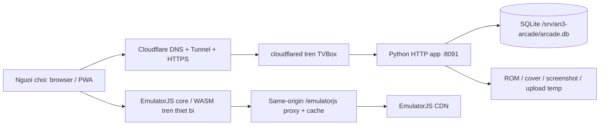

# Ban giao he thong: An 3 To Com lanh dia

Ngay cap nhat: 2026-08-09  
Trang production: `https://an3tocom.space`  
Ma nguon: `/Users/meomeo/Documents/Codex/2026-08-08/v/outputs/an3-arcade`

> Muc dich cua tai lieu nay la de mot session Codex moi co the tiep tuc van hanh va phat trien he thong ma khong can doc lai toan bo lich su chat. Tai lieu chu dong **khong** ghi mat khau, token, cookie, SSH key, hay thong tin dang nhap router/Cloudflare.

## 1. Tong quan san pham

Ten hien thi chinh thuc la **An 3 To Com lanh dia**. Day la thu vien game ca nhan/public tu host tren TVBox tai nha, voi cac dac diem:

- Game gia lap chay tren trinh duyet cua nguoi choi (WASM/canvas/Core cua EmulatorJS), khong render tren TVBox. TVBox chi luu ROM, SQLite, anh va phuc vu HTTP/range request.
- Ho tro tieng Viet va English.
- Khach chua dang nhap van co the xem, tai va choi moi game, bao gom ca `Draft`, `Testing` va game phat hanh.
- Dang nhap chi bat buoc voi danh gia 1-5 sao, binh luan, bao loi va danh sach yeu thich.
- Admin co dashboard quan ly game, nguoi dung admin, lien he, bao loi va thong ke.
- PWA co che do offline: thu vien rieng trong IndexedDB cua trinh duyet, upload ROM local va choi khong can mang; khong dang nhap, khong dong bo voi thu vien/tai khoan online.

Footer hien ghi credit cac cong cu: EmulatorJS, RetroArch, mGBA, melonDS, Azahar, Python va SQLite; kem dong `design by: Tam goi la cong tu`.

## 2. Kien truc va ha tang dang hoat dong



### Production

- Ten mien da dung Cloudflare DNS; nameserver dang la cap `barbara.ns.cloudflare.com` va `drew.ns.cloudflare.com`.
- Cloudflare da bao zone active. Duong public phu thuoc Cloudflare Tunnel, **khong phu thuoc IP WAN thay doi** hay port forward router.
- Doi public da duoc kiem tra bang HTTPS tu TVBox: `/health` tra ve `environment=production`. Source/staging hien dung fingerprint noi dung cho asset va PWA cache `v14`; production chua deploy ban NDS moi vi con cho xac nhan tren dien thoai that.
- Dich vu app: `an3-arcade.service`.
- Ma chay: `/opt/an3-arcade/app.py`.
- Du lieu ben vung: `/srv/an3-arcade`.
- File environment/secret: `/etc/an3-arcade.env` (khong duoc in ra terminal/chat). Production can co `AN3_BASE_URL=https://an3tocom.space` va `AN3_COOKIE_SECURE=1`.
- Port noi bo: `8091`.
- Cloudflared dich vu: `cloudflared.service`, active. Lenh hien dung token file `/etc/cloudflared/token`; ingress dang duoc Cloudflare managed tunnel quan ly va tro ve `http://127.0.0.1:8091`.
- Backup production gan nhat truoc lan deploy cuoi: `/opt/an3-arcade.backup-20260809-141525`.

### Router va mang

- TVBox LAN IP la `192.168.1.11`.
- Router tung duoc cau hinh Virtual Server va DMZ da tat. Tuy nhien Cloudflare Tunnel la duong public chinh, nen khong can mo port 80/443 de web hoat dong.
- Khong dung DMZ cho he thong nay. Neu giu port forward cu, coi no la phuong an LAN/direct access, khong phai yeu cau production.
- Khong ghi IP WAN vao DNS Hostinger nua; Cloudflare quan ly DNS va tunnel ket noi outbound tu TVBox.

### Staging

- Dich vu: `an3-arcade-staging.service`.
- Port: `8092` (`http://127.0.0.1:8092/health`).
- Code dang chay qua symlink: `/opt/an3-arcade-staging/current`.
- Cac release: `/opt/an3-arcade-staging/releases/<timestamp>`.
- Du lieu tach biet: `/srv/an3-arcade-staging`.
- Environment tach biet: `/etc/an3-arcade-staging.env`.
- Script deploy staging: `deploy-stage.sh`. Script tao archive, gui len TVBox, doi symlink sang release moi, restart service, health-check 60 giay va tu quay ve release truoc neu health-check loi.
- Staging hien da co mot ban sao ROM NDS `pmd-eos` chi de smoke test player. Day la du lieu staging, khong phai production.
- Release staging moi nhat: `/opt/an3-arcade-staging/releases/20260809-163053`, asset version `153d2cbf7c5e`, service `active`, PWA `v14`, COOP/COEP header va LAN port 8092 da xac minh.

## 3. Cau truc repository

```text
outputs/an3-arcade/
  app.py                         # Web server, SQLite schema, HTML routes va API
  static/
    site.css                     # Theme, responsive layout, player controls
    site.js                      # Auth UX, admin dashboard, chunked upload, PWA registration
    player.js                    # EmulatorJS player online, virtual controls, save slots
    offline.js                   # Offline library va offline player tu IndexedDB
    service-worker.js            # PWA cache, hien v12
    manifest.webmanifest         # PWA manifest
    default-cover.png
  deploy/
    an3-arcade.service           # systemd production
    an3-arcade-staging.service   # systemd staging
    cloudflared-config.yml.example
    Caddyfile.example             # chi la phuong an thay the, khong dang can cho Tunnel
  tests/test_integration.py       # integration test su dung stdlib
  deploy-stage.sh                 # release staging + rollback tu dong
  deploy.sh                       # deploy production + local backup
  README.md                       # huong dan cu, can cap nhat mot so noi dung (muc 13)
```

He thong dung Python standard library, khong co Node build hay dependency package bat buoc cho runtime.

## 4. Du lieu, thu muc va database

`AN3_DATA_DIR` mac dinh la `/srv/an3-arcade` tren production. Ben trong co:

```text
arcade.db       # SQLite, WAL mode
roms/           # file game
covers/         # cover game
screenshots/    # nhieu anh trong trang mo ta game
custom/         # game HTML5 da xu ly/asset lien quan
uploads/        # file tam cua resumable upload; tu don dep sau 24 gio
```

Bang SQLite quan trong:

- `users`: username (`name`, duy nhat, khong tu doi), `display_name`/nickname, password hash, role.
- `sessions`: hash session token, CSRF token, thoi han session 30 ngay.
- `games`: slug, tieu de/mo ta Viet-Anh, system, ROM/cover, size, `published`, `experimental`, `system_auto`, timestamp.
- `ratings`, `comments`, `favorites`, `reports`.
- `page_views`, `play_events`: dashboard thong ke luot truy cap, nguoi choi va game duoc choi nhieu.
- `game_screenshots`, `game_updates`: anh ingame va changelog theo game.
- `site_settings`: email/Facebook/cac social link cua maintainer.
- `upload_sessions`: resumable upload, ten file tam, offset da nhan, TTL 24 gio.

SQLite mo WAL va foreign key. Khong xoa truc tiep file trong `/srv/an3-arcade` neu chua kiem tra quan he trong DB va backup.

## 5. He may, dinh dang ROM va tu dong nhan dien

`app.py` co `SYSTEMS`, `EXTENSIONS` va `infer_system()` la nguon su that cho giao dien upload va offline. Cac system hien co:

- Game Boy/Color: `.gb`, `.gbc`, `.zip`, `.7z`.
- GBA: `.gba`, `.zip`, `.7z`, `.raw`.
- Nintendo DS: `.nds`, `.zip`, `.7z`.
- Nintendo 3DS: `.3ds`, `.cci`, `.cxi`, `.app`, `.zip`, `.7z`.
- NES/Famicom: `.nes`, `.fds`, `.zip`, `.7z`.
- SNES: `.sfc`, `.smc`, `.fig`, `.swc`, `.zip`, `.7z`.
- N64: `.n64`, `.z64`, `.v64`, `.zip`, `.7z`.
- PlayStation: `.bin`, `.cue`, `.chd`, `.pbp`, `.iso`, `.img`, `.zip`, `.7z`.
- PSP: `.iso`, `.cso`, `.pbp`, `.elf`, `.zip`, `.7z`.
- Sega Mega Drive, Master System, Game Gear, 32X, Sega CD, Saturn.
- Arcade/FBNeo, 3DO, Atari 2600/7800/Jaguar/Lynx, PC Engine, Amiga, Commodore 64, DOOM/PrBoom.
- HTML5: `.html` hoac `.zip` chua `index.html`.

Neu upload `.zip`, app mo archive de tim `index.html` hoac thu nhan dien cac file ben trong. Neu extension trung lap (nhu `.bin`, `.cue`, `.iso`, `.chd`) thi ten file/hint (`psx`, `gba`, `nds`, `citra`, `azahar`, v.v.) duoc dung. UI van cho admin sua he may neu auto-detect khong chac chan.

Luu y: kha nang chay thuc te phu thuoc core EmulatorJS va phan cung/trinh duyet may khach. 3DS duoc danh dau `latest`, can may client manh hon; server khong gia lap ho.

## 6. Quyen va luong nguoi dung

### Khach chua dang nhap

- Xem thu vien, chi tiet, cover, screenshot, changelog.
- Choi va tai moi game (Release, Draft, Testing deu public theo yeu cau moi nhat).
- Chuyen Online/Offline, tai core offline, upload ROM vao kho offline rieng va choi offline.
- Khong thay Dashboard; truy cap `/admin` khong thanh cong.
- Can dang nhap de danh gia, binh luan, bao loi, favorite.

### Tai khoan thuong

- Dang ky voi username, password, nhap lai password, nickname.
- Username 3-32 ky tu va khong tu doi duoc; nickname 2-40 ky tu co the cap nhat tai `/account`.
- Co danh sach game yeu thich; danh gia 1-5 sao, binh luan, gui bao loi.

### Admin

- Navbar chi them link Dashboard khi `role=admin`; loi truoc day dashboard bien mat da duoc xu ly theo dieu kien nay.
- Tao, sua, xoa game; game Draft/Testing van public.
- Upload nhieu ROM de tao ban ghi thu nghiem, sau do bo sung title/mo ta; file name la gia tri mac dinh neu bo trong.
- Tu dong nhan dien he may; sua thu cong khi can.
- Upload cover bang file hoac paste anh tu clipboard.
- Upload nhieu screenshot trong trang game; them update/changelog.
- Xoa game loi tu dashboard.
- Tao them admin va chinh sua tai khoan qua API admin. Khong them lai 2FA/WebAuthn: nguoi dung da yeu cau bo tinh nang nay.
- Xem/xu ly bao loi, chinh contact maintainer, xem thong ke.

## 7. Player online va dieu khien ao

Thanh cong cu cua player:

- Back, fullscreen, EmulatorJS menu, download/load save state, save slots, va cai dat phím ao.
- Loading hien phan tram khi tai ROM/core.
- Save state export/import tren may khach; 5 save slot local qua IndexedDB.
- Vi tri, kich thuoc va do mo phím ao luu localStorage theo he may + portrait/landscape; chinh phím khong reload/reset game.
- Che do keo tha chay bang Pointer Events; co reset default, an/hien, size va opacity.
- Hints cho menu player hien mo trong khoang 3 giay.

### Nintendo DS

Su co NDS can nho:

- EmulatorJS native virtual gamepad da bi an de tranh trung phím voi layer custom.
- Canvas cua EmulatorJS co the tu gan class `ejs-canvas-no-pointer`, lam touch cua man hinh DS khong hoat dong. `static/player.js` da chu dong xoa class nay va ep `pointer-events`/`touch-action` tren canvas cua NDS khi khoi dong. Khong bo doan nay neu dang refactor player.
- Ban sua moi dung `MutationObserver` de tiep tuc go class chan pointer neu EmulatorJS gan lai sau khi core da chay, va bridge PointerEvent/TouchEvent thanh mouse event cho man hinh cam ung NDS tren mobile.
- Core NDS hien dung `desmume` stable. ZIP GB/GBA/NDS co dung mot ROM duoc giai nen mot lan vao `DATA_DIR/prepared-roms` khi vao luong Choi; URL browser kem ten/duoi ROM that, `/download` van tra archive goc. Mau `pmd-eos` staging duoc phuc vu thanh `.nds` 134217728 byte; native DeSmuME smoke-test da load den logo Nintendo/ESRB cua intro.
- Player chuan bi EmulatorJS truoc, de `EJS_startOnLoaded=false` rieng NDS, va chi hien nut `Vao game` sau event `EJS_ready`. Click handler goi `startButtonClicked` dong bo trong chinh trusted user gesture, sau khi AudioContext/runtime da ton tai; cach cu click nut ngoai truoc khi loader chay lam gesture het hieu luc va core treo den. Chi an loading khi `EJS_onGameStart` chay; `gameManager` vua tao khong bi coi la game da san sang, loi runtime hien truc tiep va timeout sau 3 phut tinh tu luc bam `Vao game`.
- Layout mac dinh NDS da duoc cap len key `an3-pad-v4:nds:<orientation>`; viec tang version co chu y de bo layout NDS loi cu mot lan. Cac thay doi keo tha sau do van duoc luu.
- Portrait default gan theo ti le stage: D-pad `(19,76)`, L `(15,52)`, R `(85,52)`, Start `(39,61)`, Select `(62,61)`, Y `(57,64)`, X `(83,64)`, A `(57,78)`, B `(83,78)`, size `1`, opacity `0.48`. Landscape co gia tri rieng trong `ndsDefaults`.
- Can xac nhan lan cuoi tren Firefox Android/May NDS that: chon man hinh cam ung cua DS, dam bao canvas nhan touch va khong co layer phím che touch. Smoke test code/static da pass, nhung session truoc khong co thiet bi Android de thao tac truc tiep.

### GBA/GBC

Layout mac dinh da sua A/B dung chieu va Start/Select viet day du. Cac layout da chinh thu cong co the luu tu cac ban cu; nguoi dung co the bam Reset default neu muon ap dung layout moi.

## 8. PWA va offline

- Manifest: `static/manifest.webmanifest`; `start_url=/offline`, standalone.
- Service worker: `static/service-worker.js`, app shell `an3-arcade-pwa-v15`, core ben vung `an3-arcade-cores-v1`; khi activate se migrate asset EmulatorJS tu PWA cache cu sang core cache truoc khi xoa shell cu. Response chi duoc tra cho luong preload sau khi `cache.put` hoan tat.
- Cache app shell: `/`, `/offline`, CSS, `site.js`, `player.js`, `offline.js`, manifest va default cover. Tai nguyen EmulatorJS di qua `/emulatorjs/<channel>/data/...`, duoc cache tren TVBox va trong service worker cua browser.
- Khong cache chung `/game-file/...` de tranh nhan ban ROM production khong kiem soat trong Cache Storage.
- Trang `/offline` dung IndexedDB rieng cua browser. File offline khong tu dong dong bo len TVBox va khong lien quan account online.
- Offline van co auto detect, virtual controls/menu, fullscreen, import/export save, 5 save slots va core preload.
- Nut `Tai truoc core offline` tai tung core khi dang co mang; iframe `/core-preload/<system>` tai truc tiep runtime, CSS, localization, extractor, report va core binary dung voi system/capability. Khong con khoi dong ROM gia hoac coi `gameManager` vua tao la thanh cong. Tung response duoc doc het, xac minh bang Cache Storage roi moi gui `postMessage` thanh cong. UI doc Cache Storage that de hien `Da tai/Chua tai`, ten core va dung luong, co nut xoa rieng tung core; NDS xoa ca asset desmume/desmume2015/melonds cu. Marker hien la `an3-offline-core-v6:<channel>:<system>`.
- Player map `doom` sang core `prboom`; PSP/3DS bat threads khi moi truong da cross-origin isolated. Cac trang player/offline gui `Cross-Origin-Embedder-Policy: require-corp` cung COOP san co de mo `SharedArrayBuffer` tren browser ho tro.
- ID offline co fallback `getRandomValues`/timestamp khi `crypto.randomUUID` khong co; giao dich IndexedDB doi den `transaction.oncomplete`, phu hop ROM lon hon.
- Trang chu va kho offline tu dong chia game theo system. Trang chu co filter va muc Recommended uu tien GBA Release khong Testing.
- Sau deploy moi, user nen reload manh hoac dong/mo lai PWA mot lan de service worker nhan cache version moi.

## 9. Upload, file lon va dong bo thu vien

### Upload admin

- ROM direct nho dung `PUT /admin/api/games/<id>/rom`.
- File lon hon 48 MiB chuyen sang resumable upload: tao session `POST /admin/api/games/<id>/uploads`, gui `PUT /admin/api/uploads/<upload_id>` tung chunk, cuoi cung `POST .../complete`.
- Chunk mac dinh 8 MiB, max ROM mac dinh 8 GiB. Session upload cham het han sau 24 gio.
- Co API `DELETE /admin/api/uploads/<upload_id>` de huy upload dang do.
- Upload cover va screenshot co gioi han 12 MiB/file.

Voi file 3DS 1.7 GB, client se dung chunked upload de tranh loi request body lon. Nen upload tu dashboard qua LAN neu Cloudflare co gioi han upload tren plan dang dung. Chua co phep thu full 1.7 GB end-to-end trong session truoc; can test that san khi co file hop le va theo doi dung luong dia TVBox.

### Tu lam moi thu vien

`site.js` poll `/api/library-version` moi 15 giay. Khi trang dang visible va khong dang search, thu vien tu reload khi admin/NAS cap nhat game, khong can F5 thu cong.

## 10. Auth, hieu nang va bao mat

### Auth

- New account tren TVBox dung `hashlib.scrypt` voi `N=8192, r=8, p=1`; thoi gian do tren staging khoang 1.5-2.3 giay.
- Hash PBKDF2 cu `pbkdf2_sha256$310000` van duoc chap nhan. Lan dang nhap dung hash cu mat khoang 6 giay, response dang nhap duoc tra ve, sau do background daemon thread doi hash sang scrypt. Cac lan sau nhanh hon.
- Moi truong Python khong co `hashlib.scrypt` (da gap tren macOS dev) dung PBKDF2 120000 vong fallback. Production TVBox co scrypt.
- Form login/register co `#authProgress`, them class loading va khoa nut submit ngay lap tuc de nguoi dung thay tien trinh, tranh bam nhieu lan.
- `AN3_AUTH_PEPPER` van duoc app doc tu environment va duoc dung de hash mot so gia tri auth/visitor. Khong in gia tri nay ra log hay tai lieu.

### Bao mat da co

- Password hash co salt; session luu hash token trong DB; cookie `HttpOnly`, `SameSite=Lax`, va `Secure` khi `AN3_COOKIE_SECURE=1`.
- CSRF token yeu cau cho cac request thay doi trang thai.
- CSP, HSTS khi HTTPS, `X-Content-Type-Options: nosniff`, Referrer-Policy, Permissions-Policy, COOP/CORP va chong iframe.
- Validation path/file, max JSON, gioi han kich thuoc upload, khu vuc data tach biet, don dep upload temp.
- Rate limit theo hanh dong; validation comment/report chong spam (gioi han do dai, lap ky tu, link nhieu, noi dung bat thuong), cooldown/duplicate/honeypot trong flow giao dien.
- Admin API bat buoc role admin + CSRF.
- `systemd` hardening: `NoNewPrivileges`, `PrivateTmp`, `ProtectHome`, `ProtectSystem=strict`, chi cho ghi `/srv/an3-arcade`, `MemoryMax=512M`.

### Viec bao mat nen duy tri

- Trong Cloudflare: bat WAF managed rules, Bot Fight Mode va rate-limit cho `/api/login`, `/api/register`, comment/report, va cac `/admin/api/*` phu hop plan. Chua duoc ghi nhan la da cau hinh trong dashboard, can kiem tra thuc te truoc khi khang dinh.
- Backup SQLite + ROM dinh ky, va test restore. DB nho nhung ROM co the lon.
- Khong mo dashboard/SSH ra public chi vi de de debug. Cloudflare Tunnel va SSH LAN la du.
- Khong dua 2FA/WebAuthn tro lai neu khong co yeu cau moi; nguoi dung da chon luong tai khoan don gian.

## 11. API, routes va UI quan trong

Routes HTML chinh:

- `/`, `/login`, `/register`, `/account`.
- `/offline`, `/core-preload/<system>`.
- `/game/<slug>`, `/play/<slug>`, `/download/<slug>`, `/game-file/<slug>`.
- `/admin`, `/admin/game/<id>` (admin only).
- `/health`, `/service-worker.js`, `/static/...`.

API public/auth:

- `POST /api/register`, `/api/login`, `/api/logout`.
- `GET /api/library-version`.
- `POST /api/games/<id>/rating`, `/comments`, `/favorite`, `/reports`.
- `POST /api/account/display-name`.

API admin:

- Tao/sua/xoa game: `/admin/api/games` va `/admin/api/games/<id>`.
- Direct uploads: `/admin/api/games/<id>/(rom|cover|screenshot)`.
- Resumable: `/admin/api/games/<id>/uploads`, `/admin/api/uploads/<id>`, `/complete`.
- Update/changelog, xoa comment, tao/sua user/admin, site settings, status reports qua cac route `/admin/api/...` tuong ung trong `app.py`.

Khi them API moi: giu CSRF, auth role, validation response JSON va bo sung test integration truoc deploy.

## 12. Quy trinh test, staging, deploy va rollback

### Test local

Chay tu thu muc source:

```bash
PYTHONPYCACHEPREFIX=/tmp/an3-pycache python3 -m unittest -v tests/test_integration.py
```

Lan pass gan nhat test da bao gom:

- Public Draft/Testing, dashboard chi admin, khong co 2FA marker.
- Dang ky, login, rating, favorite, report, comment.
- Auto detect NDS/3DS va resumable chunk upload/download/delete.
- Tao admin thu hai.
- Offline page, manifest, service worker `v12`, proxy core cung origin, preload binary truc tiep va fingerprint asset theo noi dung.
- Marker loading login va NDS touch/layout code.
- Scrypt/fallback va compatibility PBKDF2 hash cu.

### Deploy staging truoc

```bash
./deploy-stage.sh
```

Can co access SSH toi TVBox va `/etc/an3-arcade-staging.env` da duoc tao tu truoc. Script co health check `127.0.0.1:8092/health` va rollback symlink neu loi. Kiem tra sau deploy:

```bash
curl -fsS http://127.0.0.1:8092/health
```

Do Browser tool cua Codex o session cu khong vao duoc LAN staging mot cach on dinh, live visual test tren Android van nen lam tren dien thoai that/cung Wi-Fi. Khong co SSH tunnel nao dang mo can phai dung lai.

### Deploy production

1. Chay integration test.
2. Deploy staging, health-check va smoke test manual (desktop + Android, nhat la NDS touch va upload lon).
3. Backup production va deploy release. `deploy.sh` se tao `/opt/an3-arcade.backup-<timestamp>` truoc khi ghi code moi.
4. Restart `an3-arcade.service`, kiem tra `http://127.0.0.1:8091/health` tren TVBox.
5. Kiem tra `https://an3tocom.space/health` va trang chu qua public HTTPS.
6. Hard reload/PWA re-open de lay service worker/assets moi.

`deploy.sh` yeu cau `AN3_ADMIN_PASSWORD` ngay ca khi environment production da ton tai. Day la hanh vi script hien tai; khong dua password vao command history. Neu dung script nay, truyen secret qua secure environment/askpass, khong paste vao chat.

### Rollback

- Staging: script tu rollback symlink khi health check fail; co the tro `current` ve mot release cu roi restart `an3-arcade-staging.service`.
- Production: dung thu muc `/opt/an3-arcade.backup-<timestamp>` gan nhat de khoi phuc code/static, restart `an3-arcade.service`, roi health-check. Khong dong vao `/srv/an3-arcade` khi rollback code neu khong co ly do phai rollback data migration.

## 13. Tai lieu can cap nhat

`README.md` co vai thong tin da cu, can chinh o session tiep theo:

- Van mo ta password dung PBKDF2; hien thuc te la scrypt cho hash moi, PBKDF2 chi compatibility/fallback.
- Van co phan noi domain dang parking/chi de xuat tunnel; hien production dang active qua Cloudflare Tunnel.
- Vi du environment cu co `AN3_COOKIE_SECURE=0`; production HTTPS phai dung `1`.
- Can bo sung them runbook backup/restore day du; README da cap nhat scrypt, domain active, PWA v15 va proxy/core cache ben vung.

## 14. Tinh trang kiem thu hien tai va viec can xac nhan

Da pass:

- Integration test local sau cac thay doi auth/NDS/PWA.
- Deploy staging final va health check da pass. Server cache co `mgba-wasm.data`, `desmume-wasm.data`, `desmume2015-wasm.data` va `melonds-wasm.data`; `/game-file/pmd-eos/<ten>.nds` tra raw `.nds` 134217728 byte tu prepared cache. PWA v15, core cache v1, marker core v6, nut `Vao game`, integration test 2/2 va Python/JS syntax da xac minh.
- Player da bo tai + giai nen ZIP hai lan trong browser: game online dua URL co duoi ROM truc tiep cho EmulatorJS, va server chuan bi raw ROM cho ZIP handheld. In-app Browser bi policy chan IP LAN truoc lan xac nhan UI cuoi; khong duoc dung browser khac de lach. Native DeSmuME CLI tren chinh TVBox da doc ROM code `C2SE`, CRC `8E0FB9DB`, serial `NTR-C2SE-USA` va tao khung intro co logo Nintendo/ESRB. Van can mot click xac nhan web staging tren thiet bi that; khong coi ket qua nay la mobile touch pass. Production van de lai sau xac nhan tren dien thoai that.
- Production service + Cloudflare Tunnel active; `/health` public HTTPS da tra dung marker ban moi.
- Chuc nang core/public library/admin/auth/upload chunk duoc test bang test server va payload 3DS nho.

Can test bang thiet bi that truoc/lan deploy ke tiep:

- Firefox Android: NDS canvas nhan touch o man hinh duoi; D-pad/A/B/X/Y/Start/Select/L/R dung layout, opacity va khong che thanh trinh duyet.
- Upload ROM 3DS thuc te khoang 1.7 GB qua LAN va neu can qua Cloudflare; theo doi retry/resume, disk va file tai lai.
- PWA install, cai dat offline, core preload, mo lai khi that su mat mang tren Android/desktop.
- Fullscreen va export/import save tu trinh duyet mobile.
- Cloudflare WAF/rate-limit da duoc bat dung nhu muc 10.
- Backup/restore SQLite va mot ROM mau tren TVBox.

## 15. Backlog va de xuat uu tien

### Uu tien cao

1. Xac nhan NDS touchscreen bang dien thoai that va chinh CSS/player neu thiet bi cu the van bat pointer event sai.
2. Thuc hien end-to-end upload 1.7 GB 3DS va ghi lai ket qua; neu Cloudflare chan request chunk thi uu tien dashboard qua LAN hoac cau hinh Cloudflare dung phu hop.
3. Cap nhat README theo muc 13 va them runbook backup/restore.
4. Tao task/systemd timer backup DB + manifest ROM, giu ban backup theo ngay/tuan va test restore.

### Hoan thien san pham

- Filter theo system va nhom GBA/NDS/3DS da hoan thanh; backlog con tag, filter trang thai va sort tuy chon.
- Moderation UI tot hon cho comment/report: trang thai, ly do, filter, audit log admin.
- Thumbnails/screenshot processing phia client hoac gioi han dimension de giam luu tru (giu file goc neu muon).
- Progress upload co retry/backoff, resume sau reload tab, va canh bao dung luong TVBox.
- Snapshot/thumbnail save slot, dat ten slot va xoa tung slot.
- Analytics theo ngay/7 ngay/30 ngay, privacy notice ro rang cho visitor hash.
- Trang status/health don gian chi cho admin va canh bao disk space, DB size, tunnel status.
- Hien thi compatibility warning ro rang cho core experimental nhu 3DS/Saturn.

### Nguyen tac giu vung khi phat trien

- Game phai tiep tuc render tren client, khong them server-side emulation.
- Uu tien plain Python/std library va architecture nhe cho TVBox tru khi co ly do ro rang.
- Moi thay doi co nguy co cao phai qua integration test + staging truoc production.
- Khong reset game khi doi control layout, settings, language hay menu; state cua player la local client.
- Khong day ROM offline cua nguoi dung len server tu dong va khong dong bo tai khoan online khi offline.
- Khong dat secret vao repository, README, log, screenshot hoac tai lieu handoff.

## 16. Diem bat dau de session moi tiep tuc

1. Mo repository tai `/Users/meomeo/Documents/Codex/2026-08-08/v/outputs/an3-arcade`.
2. Doc file nay, sau do doc `README.md`, `app.py`, `static/player.js`, `static/site.js` va `tests/test_integration.py`.
3. Chay integration test truoc khi sua.
4. Neu sua player/NDS: test source, deploy staging, test tren Firefox Android, sau do moi deploy production.
5. Neu sua deploy/infrastructure: giu Cloudflare Tunnel la duong public; khong quay lai phu thuoc IP WAN/DMZ.
6. Moi lan deploy production: luu ngay/asset version/ket qua health check vao changelog hoac issue de co audit trail.
