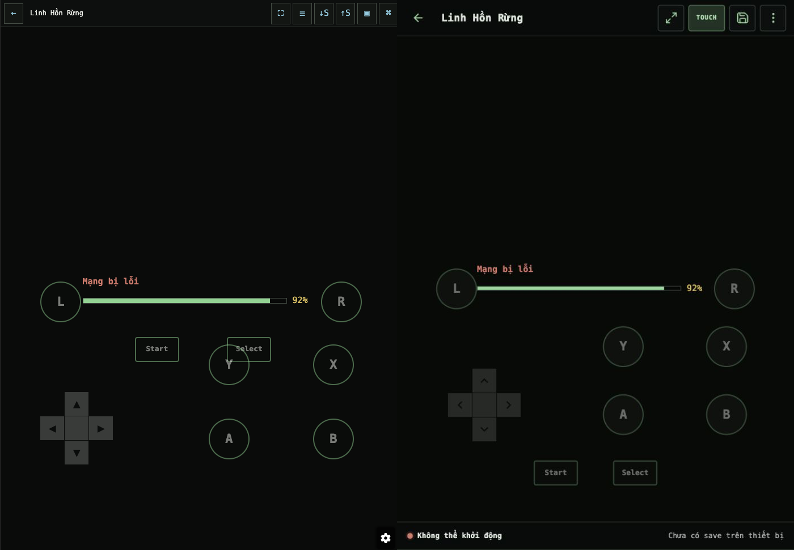
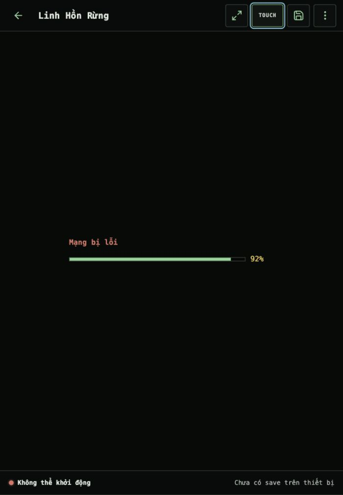
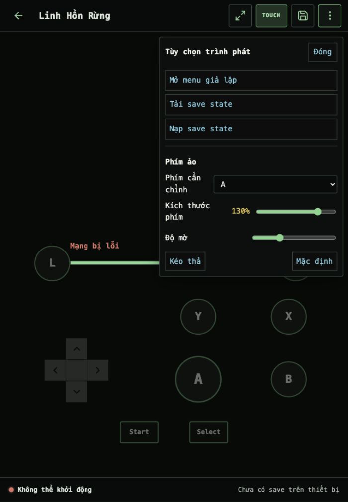

# Design QA — Gameplay Option 1 with Touch overlay

## Result

**final result: passed**

The selected Option 1 player shell and the user's explicit Touch-overlay follow-up have no unresolved P0, P1, or P2 design-QA finding in the locally available network-error state. The active-emulator and physical-device checks remain staging gates, not fabricated local evidence.

## Source visual truth

The final target combines two supplied visual sources plus the user's explicit interaction delta:

- Option 1 shell direction: `reports/ui-ux/candidates/batch-09-player-option1/reference-option1-700x1010.png`.
- Original overlay behavior: `reports/ui-ux/candidates/batch-09-player-option1/reference-original-overlay-700x1010.png`.
- Normalized overlay content reference: `reports/ui-ux/candidates/batch-09-player-option1/reference-original-overlay-content-700x971.png`.
- Explicit delta: add a persistent `Touch` toolbar button; virtual controls overlay the game; each control can be resized independently.

The original screenshot's 39 px browser chrome was removed before comparison. The normalized source is 700 × 971 px. The implementation was rendered at a 700 × 971 CSS viewport, captured at 700 × 971 px with density 1, Vietnamese locale, dark theme, and the same 92% network-error state.

Implementation: `reports/ui-ux/candidates/batch-09-player-option1/candidate-touch-final-700x971.png`.

## Full-view comparison evidence

The final implementation keeps the overlay behavior while adopting the selected compact icon toolbar, clearer title hierarchy, explicit Touch state, cleaner controller spacing, and honest runtime/save status rail.

## Focused-state evidence

The key controls are readable at the full 700 px capture, so separate crops were not needed. Two full-height focused states provide stronger context:

## Findings

- No actionable P0/P1/P2 finding remains.
- P3: at 390 and 360 px, the game title truncates to preserve four 44 px toolbar actions, including the always-visible Touch button. The full title remains in the document title and game-detail route; this is an accepted compact-player trade-off.

## Comparison history

| Iteration | Evidence/finding | Fix | Post-fix evidence |
| --- | --- | --- | --- |
| 1 | `candidate-pass1-700x1010.png`: P1 control clusters collided in the first docked implementation. | Repositioned controller defaults and separated game, status, and control regions. | `candidate-pass2-700x1010.png`. |
| 2 | The user changed the target from docked controls to overlay controls and requested Touch plus per-control sizing. This superseded the docked composition. | Restored overlay geometry, added Touch, retained pointer-transparent controller root, and added independent scale persistence. | `candidate-touch-overlay-715x1042.png` and `candidate-touch-settings-715x1042.png`. |
| 3 | Browser measurements found P1 horizontal overflow at 390/360 px, P1 A/X and X/R intersections in short landscape, and P2 loading progress obscured by L/R on mobile. | Forced the player grid to shrink, made the title flex track zero-based, revised portrait/landscape defaults, bounded per-control scale to 70–140%, and narrowed the mobile loading content track. | `candidate-touch-final-390x844.png`, `candidate-touch-final-360x800.png`, and `candidate-touch-final-landscape-844x390.png`. |
| 4 | Final normalized comparison found no remaining P0/P1/P2 issue. | Accepted. | `reference-overlay-content-vs-candidate-touch-final.png`. |

## Required fidelity surfaces

| Surface | Assessment |
| --- | --- |
| Fonts and typography | Existing CSP/offline-safe system stacks are preserved. Title weight, compact mono controller labels, error copy, status text, and panel hierarchy are clear. No external font was introduced. |
| Spacing and layout | Toolbar, game region, overlay, and status rail use explicit non-scrolling tracks. Required 700, 390, 360, and 844 × 390 viewports have no page overflow and no default control-to-control collision. |
| Colors and tokens | Near-black background, restrained green borders, cyan focus, yellow progress, and red failure status follow the selected direction. Touch has an explicit green active state without gradients or glass effects. |
| Image quality and assets | Toolbar and D-pad use local Lucide SVG assets with the bundled license. No emoji, text glyph, handcrafted SVG, CSS art, placeholder game image, or fake emulator framebuffer was substituted. |
| Copy and content | Product brand is `Ăn 3 Tô Cơm`. Touch is deliberately language-neutral. Runtime says `Không thể khởi động`; local save state honestly says `Chưa có save trên thiết bị`. |

## Functional, responsive, and accessibility checks

- 700 × 1010, 390 × 844, 360 × 800, and 844 × 390: `scrollWidth === viewport width`.
- Controller root and game rectangles match; the status rail is excluded from the overlay.
- Controller root is `pointer-events:none`; individual controls remain `pointer-events:auto`, allowing NDS touchscreen input between controls.
- Touch off sets `aria-pressed=false` and hides only the controller; the Touch button remains visible. Touch on restores the overlay. The state persists after reload.
- Selecting A at 130% updates only A (`--control-scale:1.3`); B remains `1`. The value persists after reload and Reset restores all control sizes.
- More and Save-slot panels move focus to their Close button. Escape closes each panel, synchronizes `aria-expanded`, and restores focus to its trigger.
- Toolbar actions are 42–46 px high across tested orientations; mobile actions are 44 px.
- Static input indices and the NDS touchscreen bridge remain unchanged and are protected by regression tests.

## Intentional and expected deviations

- L/R remain visible even though the generated Option 1 mock omitted them; NDS requires those controls.
- The generated mock's forest gameplay is illustrative emulator output, not an app asset. The honest local same-state comparison uses the supplied 92% network-error screenshot because the fixture has no ROM.
- The status rail reports the real save condition rather than copying the mock's `Đã lưu trên thiết bị` claim when no slot exists.
- Hiding controls is a user action through Touch; controls do not auto-hide and Touch does not hide itself.

## Test and evidence gates

- 10/10 Python tests passed, including the new Touch/per-control-size source invariant.
- Python, all four JavaScript files, and deployment/backup shell scripts pass syntax checks.
- `git diff --check` passed.
- Browser interaction and responsive evidence are recorded in `reports/ui-ux/candidates/batch-09-player-option1/README.md`.
- Runtime LCP, CLS, and INP were not available and are not claimed.

## Remaining non-design gates

- Verify ready NDS/GBA gameplay, fullscreen, rotation, controller presses, and physical multi-touch on staging with representative ROM/core data.
- Verify installed-PWA restart offline on a secure staging origin.
- No production deployment or production approval is implied by this local design-QA pass.

The earlier mobile-library Option 1 QA remains accepted; this report replaces its root summary because the player is the latest build gate. The library evidence remains under `reports/ui-ux/final/`.
