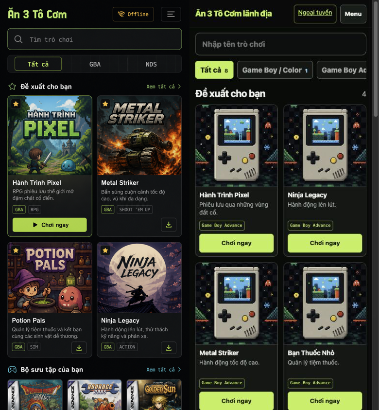
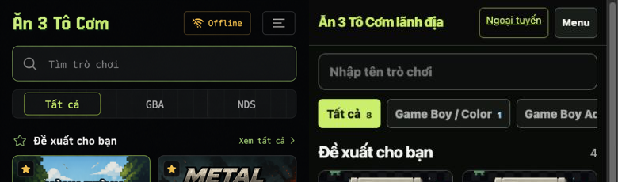
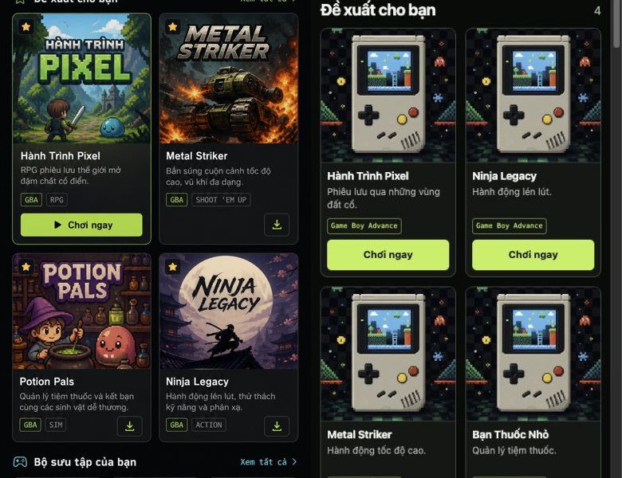
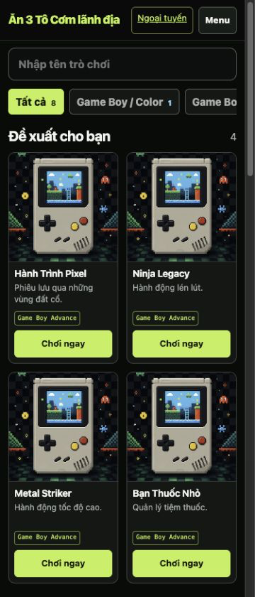

# Design QA — Selected mobile library direction

## Result

**final result: passed**

The selected Option 1 direction is implemented as the visual truth for the public mobile library. The final comparison has no unresolved P0, P1, or P2 fidelity issue. Expected product/content deviations are documented below rather than hidden.

## Normalized comparison input

| Input | Reference | Implementation |
| --- | --- | --- |
| viewport | 390 × 843 px | 390 CSS px document viewport; 390 × 843 px lossless capture |
| locale | Vietnamese | Vietnamese |
| state | populated recommended library | populated recommended library, signed-in normal user |
| cards visible | two-column artwork-led grid | two-column artwork-led grid |
| image format | PNG | PNG |

Reference: `reports/ui-ux/final/reference-option1-390x843.png`  
Final implementation: `reports/ui-ux/final/home-vi-css390x843-pass3.png`

### Focus region — header, search, filters, and section opening

### Focus region — first two rows of cards

## Comparison history

| Iteration | Evidence | Finding | Resolution |
| --- | --- | --- | --- |
| 1 | `reference-vs-implementation-pass1.png` | P2: implementation opened with excess explanatory content, cards were too tall, and language/state did not match. | Moved the guide trigger into navigation, hid the mobile intro visually while preserving its heading in the DOM, tightened discovery controls, used square mobile artwork, and normalized to Vietnamese. |
| 2 | `reference-vs-implementation-pass2.png` | P1: the long canonical Vietnamese brand squeezed the Offline and Menu controls at 390 px. P2: section opening was still slightly loose. | Changed the mobile header to a two-column brand/actions grid, protected action width, reduced header and section spacing, and hid the redundant mobile eyebrow. |
| 3 | `reference-vs-implementation-pass3.png` | No unresolved P0/P1/P2. The 360 px follow-up also has zero page-level overflow and fully visible 40 px header controls. | Accepted. |

## Fidelity review

| Surface | Final assessment |
| --- | --- |
| typography | Strong condensed hierarchy is preserved with the existing system-font/CSP-safe stack: heavy lime brand, high-contrast white section titles, compact metadata, and clear CTA labels. |
| spacing | Search, filter rail, section opening, two-column gutters, card internals, and CTA spacing follow the compact reference rhythm. |
| color | Near-black surfaces, lime primary actions, restrained green borders, white hierarchy, and muted secondary copy match the selected direction without adding gradients or glass effects. |
| composition | Artwork is dominant; search and horizontal filters remain above the first two-column library; four complete cards are visible in the first 843 px at 360 px width. |
| hierarchy | Find/filter → recommended collection → artwork → title/description/system → Play is clear. Play remains the primary action as required by the production brief. |

## Functional and responsive checks

- 390 px document width: `scrollWidth === clientWidth === 390`.
- 360 px document width: `scrollWidth === clientWidth === 360`.
- At 360 px, Offline and Menu are both fully visible and each is 40 px high.
- Mobile Menu opens with `aria-expanded="true"`; Games, guide, account, logout, and language remain reachable.
- The guide moves focus to Close, traps focus, closes with Escape, and restores focus to the mobile Menu trigger.
- Search, clear-search, filters, cards, detail links, and Play remain functional; no visual-only replacement was introduced.

360 px evidence: `reports/ui-ux/final/home-vi-css360x840-pass3.png`

## Intentional and expected deviations

- The production brand remains the canonical `Ăn 3 Tô Cơm lãnh địa`, rather than shortening it to the mock's `Ăn 3 Tô Cơm`.
- The existing system font stack is retained. Adding an external pixel font would conflict with the CSP, offline, and performance goals.
- The local fixture intentionally uses the real optimized fallback cover repeatedly. Artwork variety is a staging-data gate; production-looking cover art was not fabricated.
- Cards keep a clear Play action, per the master brief, instead of copying the reference's download-only secondary action.
- Decorative star/controller/download glyphs from the concept are not approximated with emoji, CSS drawings, or handwritten SVG. Existing semantic text and real product controls are used.

## Evidence integrity

The reference and all accepted implementation files are lossless PNGs. The final files are exact-width captures rather than width inferred from a filename. SHA-256 values are recorded in the final evidence directory and can be regenerated with `shasum -a 256 reports/ui-ux/final/*.png`.
