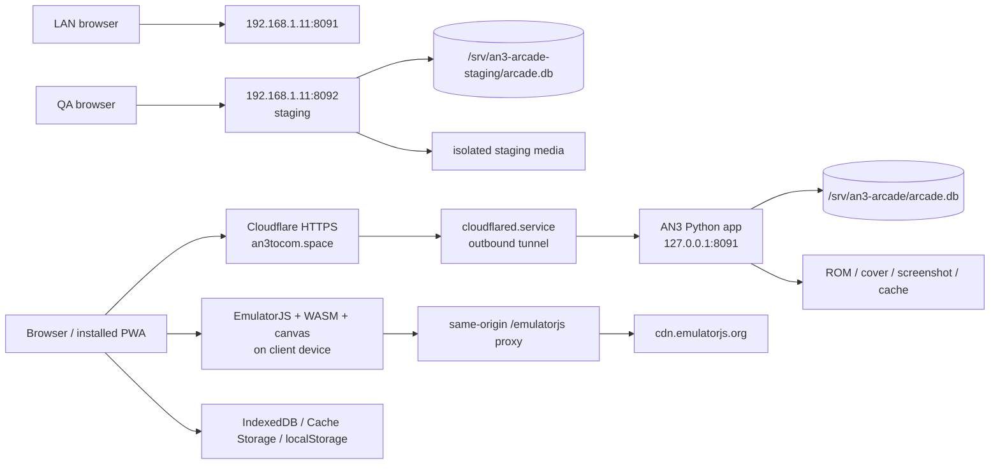

> Status: archival. Retired workstation/session snapshot; historical paths and
> operational authority are not current. Original body retained below. Use the
> current repository guide and documentation index for new work.

# AN3 Arcade — Full system and operations handoff

Recorded: `2026-08-13`

Timezone: `Asia/Ho_Chi_Minh`

Product name: **Ăn 3 Tô Cơm**

Public production: `https://an3tocom.space`

LAN production: `http://192.168.1.11:8091`

LAN staging: `http://192.168.1.11:8092`

> **INTERNAL OPERATIONS DOCUMENT**
>
> This file contains private LAN topology, SSH host/user information, filesystem paths, service names, release identifiers, and rollback locations. It intentionally does **not** contain passwords, tokens, cookies, private keys, environment-file contents, production database rows, or Cloudflare credentials. Keep it in the private repository and do not publish it.

## 1. Authority and reading order

If documents disagree, use this order:

1. Current source, tests, `AGENTS.md`, deployment scripts, and live `/health` responses.
2. This handoff.
3. Current QA reports under `reports/`.
4. `HANDOFF-AN3-ARCADE-2026-08-11.md` for NDS recovery provenance.
5. `SESSION-HANDOFF-2026-08-09.md` only for historical context; it is explicitly superseded and contains obsolete DeSmuME/manual-start descriptions.

Important historical security note: the external file `/Users/meomeo/Documents/an3tocom UI UX /AN3-ARCADE-SESSION-HANDOFF-2026-08-12.md` contains a plaintext SSH credential. Do not copy that value into this repository, chat, logs, screenshots, commands, or new handoffs. Treat the credential as rotation-worthy and keep the external file restricted.

## 2. Current release snapshot

Snapshot verified on `2026-08-13` around `17:00 ICT`.

| Item | Current value |
| --- | --- |
| Workspace | `/Users/meomeo/Documents/Codex/2026-08-12/an3-arcade-production-ui-ux-codex/an3-arcade` |
| Active branch | `ui/production-ux-refresh` |
| Release commit | `839a797087c3134c4d46bc5629389a0d13d6d5a5` |
| Release commit subject | `Record reference-matched library QA` |
| Git state at handoff start | clean; branch ahead of local `origin/ui/production-ux-refresh` by 5 commits |
| Git remote | local filesystem remote: `/Users/meomeo/Documents/Codex/2026-08-11/an3-arcade` |
| GitHub/GitLab remote | none configured |
| Production asset fingerprint | `a9fba74659b5` |
| Staging asset fingerprint | `861033db66b8` |
| Staging release directory | `/opt/an3-arcade-staging/releases/20260813-163145` |
| Production code rollback | `/opt/an3-arcade.backup-20260813-164130` |
| Production DB predeploy rollback | `/srv/an3-arcade/backups/arcade-predeploy-20260813-164130.db` |
| PWA shell | `an3-arcade-pwa-v20` |
| Persistent browser core cache | `an3-arcade-cores-v1` |
| Offline core marker | `an3-offline-core-v7:<channel>:<system>` |

Production was explicitly approved and deployed from release commit `839a797`. The production app does not receive `.git`; the deployable runtime is identified by the source commit recorded here plus its content-derived asset fingerprint.

Live verification:

- `https://an3tocom.space/health`: HTTP/2 200, Cloudflare, environment `production`, asset `a9fba74659b5`.
- `http://192.168.1.11:8091/health`: environment `production`, asset `a9fba74659b5`.
- `http://192.168.1.11:8092/health`: environment `staging`, asset `861033db66b8`.
- `an3-arcade.service`, `an3-arcade-staging.service`, `an3-arcade-backup.timer`, and `cloudflared.service`: active.
- Production and staging configuration files and the Cloudflare token file are mode `0600`, owner `root:root`.
- TVBox root filesystem: 15 GiB total, about 3.3 GiB used and 11 GiB available at verification time.

## 3. System topology



Core architectural rule: emulation runs on the player's browser/device. The TVBox stores data and serves HTTP/Range/static/proxy responses; it does not render or emulate games server-side.

## 4. TVBox host and runtime

| Item | Value |
| --- | --- |
| Hostname | `tvbox` |
| LAN IP | `192.168.1.11` |
| Architecture | `aarch64` |
| Kernel at verification | `Linux 6.12.56-meson64` |
| Python at verification | `3.13.7` |
| SSH | TCP `22`, listening on IPv4 and IPv6 |
| Production HTTP | TCP `8091`, bound to `0.0.0.0` |
| Staging HTTP | TCP `8092`, bound to `0.0.0.0` |
| Runtime user/group | `tvshare:tvshare` |
| systemd memory cap | 512 MiB per AN3 app unit |

The services use `NoNewPrivileges=true`, `PrivateTmp=true`, `ProtectHome=true`, `ProtectSystem=strict`, `UMask=0027`, and only allow writes inside their respective `/srv` data paths.

## 5. SSH access and secret handling

### 5.1 Connection information

```text
SSH_HOST=192.168.1.11
SSH_PORT=22
SSH_USER=root
SSH_TARGET=root@192.168.1.11
```

Local askpass helper currently used by the authorized deployment workflow:

```text
/Users/meomeo/Documents/Codex/2026-07-29/ha/work/ssh-askpass-tvbox.sh
```

The helper existed and was executable at verification time. Its contents were not copied into this handoff. It was mode `0755`, which makes it readable/executable by other local users; because an askpass helper may expose a credential, restrict it to the owner, preferably mode `0700`, and rotate the underlying password if the machine is shared or the plaintext historical handoff was exposed.

Never put the SSH password in:

- this file or another committed Markdown file;
- a shell command, shell history, issue, comment, screenshot, or chat;
- `deploy.sh`, `deploy-stage.sh`, `.env`, Git config, or source code;
- terminal output collected for QA.

### 5.2 Authorized askpass pattern

From the repository root:

```bash
SSH_ASKPASS="/Users/meomeo/Documents/Codex/2026-07-29/ha/work/ssh-askpass-tvbox.sh" \
SSH_ASKPASS_REQUIRE=force \
DISPLAY=:0 \
ssh -n -o ConnectTimeout=8 \
  -o StrictHostKeyChecking=no \
  -o UserKnownHostsFile=/dev/null \
  root@192.168.1.11 'hostname'
```

The existing deployment scripts also disable strict host-key checking and do not retain `known_hosts`. That avoids interactive prompts but is susceptible to LAN man-in-the-middle attacks. A future hardening task should capture the TVBox ED25519 host-key fingerprint through a trusted local channel, pin it in a dedicated known-hosts file, and remove `StrictHostKeyChecking=no`. No unverified fingerprint is recorded here.

### 5.3 Safe read-only SSH checks

```bash
SSH_ASKPASS="/Users/meomeo/Documents/Codex/2026-07-29/ha/work/ssh-askpass-tvbox.sh" \
SSH_ASKPASS_REQUIRE=force DISPLAY=:0 \
ssh -n -o ConnectTimeout=8 -o StrictHostKeyChecking=no \
  -o UserKnownHostsFile=/dev/null root@192.168.1.11 \
  'systemctl is-active an3-arcade.service an3-arcade-staging.service cloudflared.service; \
   curl -fsS http://127.0.0.1:8091/health; echo; \
   curl -fsS http://127.0.0.1:8092/health; echo; \
   df -h /'
```

Do not run `cat`, `grep`, `env`, `systemctl show -p Environment`, or similar commands against `/etc/an3-arcade.env`, `/etc/an3-arcade-staging.env`, `/etc/cloudflared/token`, or process environments. Check only file existence, owner, and mode when needed.

## 6. Production and staging separation

| Concern | Production | Staging |
| --- | --- | --- |
| App path | `/opt/an3-arcade` | `/opt/an3-arcade-staging/current` |
| Release model | copied in place | timestamped releases + `current` symlink |
| Data path | `/srv/an3-arcade` | `/srv/an3-arcade-staging` |
| Environment file | `/etc/an3-arcade.env` | `/etc/an3-arcade-staging.env` |
| systemd unit | `an3-arcade.service` | `an3-arcade-staging.service` |
| Port | `8091` | `8092` |
| Environment marker | `production` | `staging` |
| Debug touch telemetry | disabled | allowed only with `ndsdebug=1` |
| Cookie/data namespace | production | isolated staging |

Never point staging at `/srv/an3-arcade`, never point production at `/srv/an3-arcade-staging`, and never copy a production database/ROM library into staging merely to make screenshots look populated without explicit authorization and a privacy review.

## 7. Repository structure

```text
an3-arcade/
  AGENTS.md
  app.py                         # 1,825 lines; server, schema, routes, templates, API
  static/
    site.css                     # global styles plus scoped library/player surfaces
    site.js                      # library/auth/account/admin behavior
    player.js                    # EmulatorJS, core preload, NDS bridge, saves, TVPad
    offline.js                   # browser-local ROM library and offline player markup
    service-worker.js            # PWA shell v20 and persistent core-cache routing
    manifest.webmanifest
    default-cover.webp           # active 29 KiB fallback in app shell
    default-cover.png            # legacy/larger fallback asset, not shell-preloaded
    fonts/                       # local Pixelify Sans + Roboto Condensed
    ui-*.svg                     # local Lucide-derived interface icons
  tests/
    test_auth_redirects.py
    test_integration.py
    test_regression_invariants.py
  deploy/
    an3-arcade.service
    an3-arcade-staging.service
    an3-arcade-backup.service
    an3-arcade-backup.timer
    an3-arcade-backup.sh
    cloudflared-config.yml.example
    Caddyfile.example
  deploy-stage.sh
  deploy.sh
  reports/
  design-qa.md
```

There is no required runtime package manager, Python requirements file, Node build, bundler, UI framework, or external component library. Runtime is Python standard library + SQLite + browser JavaScript.

Current approximate source weights:

| Asset | Raw | gzip when measured |
| --- | ---: | ---: |
| `app.py` | 129,953 B | not recorded |
| `site.css` | 80,410 B | 15,543 B |
| `site.js` | 24,572 B | 6,070 B |
| `player.js` | 49,504 B | 12,854 B |
| `offline.js` | 31,632 B | 9,956 B |
| `service-worker.js` | 3,544 B | 1,186 B |
| entire `static/` tree | about 1,288 KiB on disk | not recorded |

## 8. Configuration variables

The following names are supported. Secret values are deliberately omitted.

| Variable | Purpose / default |
| --- | --- |
| `AN3_APP_DIR` | Application root; production `/opt/an3-arcade` |
| `AN3_DATA_DIR` | Persistent data root; production `/srv/an3-arcade` |
| `AN3_HOST` | Bind address; default `0.0.0.0` |
| `AN3_PORT` | HTTP port; default `8091` |
| `AN3_BASE_URL` | Canonical origin; production should be `https://an3tocom.space` |
| `AN3_COOKIE_SECURE` | `1` on public HTTPS production; `0` only on LAN/local development |
| `AN3_ENVIRONMENT` | `production`, `staging`, or `development`; controls staging badge/debug allowance |
| `AN3_AUTH_PEPPER` | secret authentication/visitor pepper; never print or document the value |
| `AN3_ADMIN_NAME` | bootstrap admin username |
| `AN3_ADMIN_PASSWORD` | bootstrap secret; never pass through chat or command history |
| `AN3_MAX_ROM_BYTES` | max ROM size; default 8 GiB |
| `AN3_UPLOAD_CHUNK_BYTES` | resumable chunk size; default 8 MiB |
| `AN3_MAINTAINER_EMAIL` | initial maintainer contact if DB setting is absent |
| `AN3_BACKUP_DIR` | optional backup directory override; default `<data>/backups` |

`bootstrap_admin()` creates an admin if missing or ensures an existing matching user has the `admin` role. It does not reset an existing admin's password from the environment on every restart.

Recommended production invariants:

```text
AN3_APP_DIR=/opt/an3-arcade
AN3_DATA_DIR=/srv/an3-arcade
AN3_HOST=0.0.0.0
AN3_PORT=8091
AN3_BASE_URL=https://an3tocom.space
AN3_COOKIE_SECURE=1
AN3_ENVIRONMENT=production
```

Recommended staging invariants:

```text
AN3_APP_DIR=/opt/an3-arcade-staging/current
AN3_DATA_DIR=/srv/an3-arcade-staging
AN3_HOST=0.0.0.0
AN3_PORT=8092
AN3_BASE_URL=http://192.168.1.11:8092
AN3_COOKIE_SECURE=0
AN3_ENVIRONMENT=staging
```

Do not overwrite existing `/etc/an3-arcade*.env` files during a normal release.

## 9. Server-side data and SQLite

Production data root:

```text
/srv/an3-arcade/
  arcade.db
  arcade.db-wal / arcade.db-shm  # may exist while WAL is active
  roms/
  covers/
  screenshots/
  custom/
  uploads/
  emulatorjs-cache/
  prepared-roms/
  backups/
```

SQLite enables `foreign_keys=ON` and `journal_mode=WAL` for each connection.

Tables:

| Table | Responsibility |
| --- | --- |
| `users` | immutable username, display nickname, password hash, role |
| `sessions` | hashed session token, CSRF token, expiry |
| `games` | bilingual title/description, system, file paths, status, timestamps |
| `ratings` | one 1–5 rating per user/game |
| `comments` | authenticated comments |
| `favorites` | user collection |
| `reports` | authenticated issue reports and moderation status |
| `site_settings` | maintainer contact configuration |
| `page_views` | visitor-hash analytics |
| `play_events` | player launches / popularity |
| `game_screenshots` | screenshot file references |
| `game_updates` | bilingual per-game changelog |
| `upload_sessions` | resumable upload ID, offset, temp name, TTL |

Do not hand-edit production database rows or remove media files independently of their database records. Admin delete logic also removes cover, ROM, screenshots, upload temp files, prepared ROMs, and custom-game directories.

## 10. HTTP routes and APIs

### 10.1 Public/user-facing routes

- `/` — online library.
- `/login`, `/register`, `/account`.
- `/game/<slug>` — game detail.
- `/play/<slug>` — online player.
- `/download/<slug>` — original download, attachment disposition.
- `/game-file/<slug>/<browser-name>` — playable stream with HTTP Range support.
- `/offline` — device-local ROM/core library.
- `/core-preload/<system>` — hidden same-origin core preload frame.
- `/cover/<game-id>`, `/screenshot/<id>`, `/custom/<game-id>/...`.
- `/emulatorjs/<stable|latest>/data/...` — validated same-origin EmulatorJS proxy/cache.
- `/static/...`, `/service-worker.js`, `/health`.
- `/admin`, `/admin/game/<id>` — admin-only pages.

### 10.2 Public/auth APIs

- `POST /api/register`, `/api/login`, `/api/logout`.
- `GET /api/library-version`.
- `POST /api/games/<id>/rating`.
- `POST /api/games/<id>/comments`.
- `POST /api/games/<id>/favorite`.
- `POST /api/games/<id>/reports`.
- `POST /api/account/display-name`.

### 10.3 Admin APIs

- Create/update/delete game: `/admin/api/games`, `/admin/api/games/<id>`.
- Direct upload: `PUT /admin/api/games/<id>/(rom|cover|screenshot)`.
- Resumable upload: create `/admin/api/games/<id>/uploads`, send chunks to `/admin/api/uploads/<id>`, then `/complete`; `DELETE` cancels.
- Game updates/changelog, comment deletion, user/admin management, site settings, and report status live under `/admin/api/...`.

All state-changing authenticated/admin APIs must retain CSRF validation, role validation, rate limits, length/path checks, and JSON error behavior.

## 11. Main product journeys

1. Browse/search/filter library → open detail → Play or Download.
2. Start player → emulator/core load → touch/virtual controls → save/fullscreen/menu.
3. Prepare offline while online → verify secure context/app shell/core → store local ROM → disconnect/restart → play.
4. Admin login → add/find/edit game → upload ROM/cover/screenshots → publish/test → inspect reports.
5. Login → return to the intended game → favorite/rate/comment/report.
6. Account → edit nickname → revisit favorites.

The green/amber Online/Offline header control is a navigation destination. It is not a reliable claim about network connectivity, app-shell cache, core cache, or ROM readiness. The offline page displays those facts separately.

## 12. Emulator and system mapping

The Python `SYSTEMS`, browser `primaryCores`, and offline system maps are duplicated and must be changed together.

| System | EmulatorJS channel | Primary core |
| --- | --- | --- |
| GB/GBC | stable | `gambatte` |
| GBA | stable | `mgba` |
| NDS | stable | `melonds` |
| 3DS | latest | `azahar` |
| NES | stable | `fceumm` |
| SNES | stable | `snes9x` |
| N64 | stable | `mupen64plus_next` |
| PSX | stable | `pcsx_rearmed` |
| PSP | stable | `ppsspp` |
| Mega Drive | stable | `genesis_plus_gx` |
| Master System | stable | `smsplus` |
| Game Gear | stable | `genesis_plus_gx` |
| Sega 32X | stable | `picodrive` |
| Sega CD | stable | `genesis_plus_gx` |
| Saturn | stable | `yabause` |
| Arcade | stable | `fbneo` |
| 3DO | stable | `opera` |
| Atari 2600 | stable | `stella2014` |
| Atari 7800 | stable | `prosystem` |
| Jaguar | stable | `virtualjaguar` |
| Lynx | stable | `handy` |
| PC Engine | stable | `mednafen_pce` |
| Amiga | stable | `puae` |
| C64 | stable | `vice_x64sc` |
| Doom | stable | `prboom` |
| HTML5 | native | sandboxed iframe, no EmulatorJS core |

PSP and 3DS request threaded cores and require WebGL 2 plus a cross-origin-isolated context with `SharedArrayBuffer`.

## 13. Player and NDS safety invariants

The player is a high-risk surface. Read all of `static/player.js` before changing player DOM/CSS/input. UI work is not permission to refactor emulator behavior.

Mandatory invariants:

- `window.EJS_startOnLoaded = true` for the current flow.
- NDS uses `retroarch_core: "melonds"`; do not reintroduce DeSmuME/manual-start behavior.
- Default NDS touch variant is `geometry-mapped`.
- `?touch=hybrid-root` and other query variants remain diagnostic controls, not the default.
- NDS canvas must have `pointer-events:auto` and `touch-action:none`.
- Remove recurring `ejs-canvas-no-pointer` using the existing protection/observer.
- Preserve the NDS touch-to-mouse bridge and mapped 256×192 cursor geometry.
- NDS debug telemetry is allowed only in `staging`/`development` and only with `ndsdebug=1`; it is bounded and exportable, never active by default in production.
- Do not place new overlays/sticky controls above the NDS touchscreen or steal pointer events.
- If a desired visual requires changing NDS input logic, record `BLOCKED_FOR_SEPARATE_TOUCH_TASK`.
- The fullscreen target is the complete `.player-shell`, not only the game stage; toolbar, Touch, Save, More, status rail, and open panels must stay available.
- `#tvPad` root remains pointer-transparent while individual controls remain interactive.
- Native EmulatorJS virtual gamepad stays hidden when the custom pad is active.

NDS ZIP delivery is deliberate:

- `/download/<slug>` returns the original uploaded archive.
- `/game-file/...` also keeps the original NDS ZIP so melonDS can unpack it client-side and transfer fewer bytes.
- GB/GBA ZIPs containing exactly one valid ROM may be extracted once into `prepared-roms/` for play; original download remains unchanged.
- `serve_file()` must continue to support `Accept-Ranges`, HTTP 206, and correct `Content-Range`.

## 14. Virtual controls and saves

Player toolbar:

- Back.
- Fullscreen.
- persistent `Touch` toggle; it hides/shows only virtual controls and never hides itself.
- five local save slots.
- More/options panel with EmulatorJS menu and state export/import.

Virtual-control state is browser-local:

```text
layout:   an3-pad-v4:nds:<portrait|landscape>
settings: an3-pad-settings-v2:nds
other:    an3-pad-v3:<system>:<portrait|landscape>
```

Each control has an independent scale from 70% to 140%. NDS default opacity is 48%. Default special sizes are D-pad 140%, Start 70%, Select 70%, others 100%.

Approved NDS defaults:

| Control | Portrait x/y (%) | Landscape x/y (%) |
| --- | --- | --- |
| D-pad | 23.4 / 81.6 | 13 / 69 |
| A | 89 / 80 | 90 / 65 |
| B | 78.2 / 89.7 | 80 / 76 |
| X | 78 / 70.2 | 90 / 38 |
| Y | 67.3 / 79.9 | 80 / 50 |
| L | 8.1 / 63.3 | 13 / 18 |
| R | 91.2 / 62.5 | 87 / 18 |
| Start | 47.4 / 62.1 | 40 / 90 |
| Select | 57.9 / 62 | 60 / 90 |

Save slots use IndexedDB `an3-arcade-save-slots`, five slots per game/device. EmulatorJS state export/import and slot storage are separate from server accounts and are not synchronized.

## 15. PWA and offline architecture

Manifest:

- name/short name: `Ăn 3 Tô Cơm`;
- `start_url=/offline`;
- `scope=/`;
- `display=standalone`.

Service worker:

- versioned app shell: `an3-arcade-pwa-v20`;
- persistent core cache: `an3-arcade-cores-v1`;
- activation migrates EmulatorJS assets from older versioned shells before deleting stale shells;
- same-origin navigations are network-first with cached `/`, `/offline` fallback;
- app assets and EmulatorJS assets are cached separately;
- `/game-file/` is explicitly excluded from shared PWA caching to avoid silently duplicating production ROMs.

Browser storage contracts:

| Storage | Purpose |
| --- | --- |
| IndexedDB `an3-arcade-offline`, store `games` | device-local ROM library |
| IndexedDB `EmulatorJS-core`, store `core` | EmulatorJS-compatible core records |
| Key `?EJS_KEYS!` | EmulatorJS core index contract |
| Cache Storage `an3-arcade-cores-v1` | runtime/report/extractor/core asset persistence |
| localStorage `an3-offline-core-v7:*` | UI readiness marker, not sufficient proof by itself |

Core preload is report-first: fetch the core report, select the correct threaded/WebGL2 binary, fetch runtime/localization/extractors/core, cache responses, write the binary into the EmulatorJS IndexedDB contract, read it back, and only then report ready.

Offline readiness consists of separate facts:

1. browser-reported network state;
2. secure context;
3. cached app shell/service worker;
4. core available and verified;
5. ROM stored in the browser-local library.

HTTP LAN can use IndexedDB but does not guarantee persistent Service Worker/Cache Storage behavior. Installed/offline-after-restart validation must use HTTPS or localhost. Offline ROMs are private to one browser profile and are never uploaded or account-synchronized automatically.

## 16. Authentication, authorization, and security

Authentication:

- username 3–32 characters, immutable;
- display nickname 2–40 characters, editable;
- passwords must be 10–200 characters, match confirmation, and use at least two of lowercase, uppercase, number, or symbol groups;
- new hashes use scrypt where available: `N=8192`, `r=8`, `p=1`, 16-byte salt, 32-byte digest;
- PBKDF2 hashes remain readable for compatibility/fallback and are upgraded after successful login when scrypt is available;
- sessions last 30 days; visitor cookie lasts one year;
- session token is stored hashed in SQLite;
- cookies are `HttpOnly`, `SameSite=Lax`, and `Secure` when `AN3_COOKIE_SECURE=1`;
- state changes use CSRF tokens.

Authorization:

- guests can browse, play, and download public/Draft/Testing content;
- login is required for rating, comments, favorites, and reports;
- admin role is required for dashboard, game/user/report/settings management, and uploads.

Security controls:

- request/body/file-size limits and safe-path validation;
- upload TTL and temp cleanup;
- in-memory action/IP rate limits;
- honeypot, duplicate/cooldown/quota, and spam-pattern checks for comments/reports;
- CSP, HSTS on HTTPS, `nosniff`, Referrer Policy, Permissions Policy, COOP/CORP, same-origin framing rules;
- custom HTML5 games run in a restricted iframe sandbox;
- EmulatorJS proxy only accepts `stable|latest`, validated paths, HTTPS CDN redirects to `cdn.emulatorjs.org`, and caches non-empty assets.

Limitations:

- rate-limit memory resets when the process restarts;
- Cloudflare WAF, Bot Fight Mode, and dashboard rate-limit settings have not been independently verified in the Cloudflare control plane;
- SSH root login is available on the LAN and existing scripts skip host-key verification;
- environment secrets remain single-host files, not a managed secret store.

## 17. Admin upload and content lifecycle

Limits:

- ROM: default maximum 8 GiB.
- Cover: 12 MiB.
- Screenshot: 12 MiB.
- JSON: 1 MiB.
- Upload chunk: default 8 MiB.
- Resumable upload TTL: 24 hours.

Small/direct uploads use `PUT /admin/api/games/<id>/<kind>`. Larger ROMs use a create/chunk/complete session. Upload from the LAN dashboard for very large files to avoid public-proxy limits and unnecessary tunnel traffic.

System detection uses extension, filename hints, and ZIP central-directory inspection. ZIP with `index.html` becomes HTML5. Ambiguous formats such as BIN/CUE/ISO/CHD require filename hints or admin confirmation.

Do not claim the approximately 1.7 GiB 3DS upload path is proven until an actual authorized end-to-end test checks resume, disk usage, final download, and cleanup.

## 18. UI state and component boundaries

Current production UI:

- product title is `Ăn 3 Tô Cơm`;
- library layout matches the approved dark arcade reference with artwork dominance, compact two-column mobile cards, Pixelify Sans brand, Roboto Condensed UI copy, and local Lucide icons;
- scoped `library-shell` styles avoid changing player geometry;
- search/filter/menu behaviors and mobile widths 360/390/768/1280 were verified without horizontal overflow;
- production keeps real titles, covers, routes, and system data rather than generated-reference artwork/genre tags.

Shared implementation seams that can regress:

- game-card markup is separately produced for homepage, account, and offline JavaScript;
- player toolbar/save-slot/pad markup is duplicated between Python online player and `offline.js`;
- system/core maps exist in Python, `player.js`, and `offline.js`;
- `site.css` is global, so broad button/input/type resets may affect the player or EmulatorJS-injected UI;
- `site.js` loads on all normal layouts, including admin behavior;
- offline page must load `offline.js` before `player.js`.

Keep consumer/admin typography and tokens scoped away from `.player-page`, `#game`, `.player-stage`, and `#tvPad`. Freeze player stage/canvas transforms, z-order, and pointer behavior unless doing a separately authorized player task.

## 19. Local development and tests

### 19.1 Local preview

```bash
AN3_DATA_DIR="$PWD/work/ui-baseline-data" \
AN3_HOST=127.0.0.1 \
AN3_PORT=18793 \
AN3_BASE_URL=http://127.0.0.1:18793 \
AN3_ENVIRONMENT=development \
AN3_COOKIE_SECURE=0 \
python3 app.py
```

Use a separate test data directory. Do not point local development at production/staging `/srv` paths.

### 19.2 Required automated checks

```bash
python3 -m unittest discover -s tests -v

PYTHONPYCACHEPREFIX="$PWD/work/pycache-check" \
python3 -m py_compile app.py

node --check static/site.js
node --check static/player.js
node --check static/offline.js
node --check static/service-worker.js

bash -n deploy-stage.sh deploy.sh deploy/an3-arcade-backup.sh
git diff --check
```

Last full release run: 12/12 Python tests passed. Current coverage protects auth redirects, public/admin flows, uploads, system inference, admin CSP-compatible progress/chart behavior, melonDS touch, default pad layout, Touch/per-control sizing, fullscreen shell, offline core storage/cache contract, NDS ZIP delivery, and HTTP Range behavior.

Coverage gaps:

- no automated real-browser JavaScript suite;
- no automated physical multi-touch/NDS regression;
- no automated installed-PWA restart-offline test;
- no automated accessibility engine;
- no stable runtime LCP/CLS/INP baseline;
- no authorized full-size 3DS upload test.

## 20. Visual QA workflow

Before UI changes:

1. inspect Git status and routes;
2. capture exact-width baselines at 1440, 1280, 768, 390, and 360 px;
3. record environment, asset fingerprint, locale, auth state, dataset state, CSS viewport, image dimensions/MIME/hash;
4. use real staging data when possible and label sparse fixtures honestly;
5. compare reference and candidate at equal density in the same image;
6. test search, filters, menu, detail, player, offline, account, admin, and error/loading/empty states as applicable;
7. run tests and accessibility/mobile checks after each batch;
8. commit a small logical change;
9. stage before production;
10. never use production as a design-review environment.

Current library design QA: `design-qa.md` and `reports/ui-ux/candidates/batch-12-reference-library/README.md`.

Player QA history:

- `reports/ui-ux/candidates/batch-09-player-option1/`;
- `reports/ui-ux/candidates/batch-10-default-nds-layout/`;
- `reports/ui-ux/candidates/batch-11-fullscreen-toolbar/`.

## 21. Staging deployment runbook

Preconditions:

- clean/understood Git state;
- full tests and syntax checks pass;
- `/etc/an3-arcade-staging.env` exists;
- SSH helper is available and authorized;
- staging health currently passes.

Command from repo root:

```bash
SSH_ASKPASS="/Users/meomeo/Documents/Codex/2026-07-29/ha/work/ssh-askpass-tvbox.sh" \
SSH_ASKPASS_REQUIRE=force DISPLAY=:0 \
./deploy-stage.sh
```

What `deploy-stage.sh` does:

1. archives only `app.py`, `static`, `deploy`, and `README.md`;
2. copies archive to TVBox `/tmp`;
3. creates `/opt/an3-arcade-staging/releases/<timestamp>`;
4. installs source and the staging systemd unit;
5. updates `/opt/an3-arcade-staging/current` symlink;
6. restarts staging;
7. polls loopback `/health` for up to 60 seconds and requires `environment=staging`;
8. automatically restores the previous symlink and restarts if the health gate fails.

Post-deploy:

```bash
curl -fsS http://192.168.1.11:8092/health
```

Then verify the actual changed journeys, responsive widths, browser logs, NDS player if touched, PWA/offline if touched, and record the asset fingerprint.

## 22. Production preflight and deployment

Production requires explicit user approval for the exact staged release. A previous approval does not automatically authorize a future release.

Preflight checklist:

- Git tree understood and release SHA recorded.
- Tests/syntax/diff checks pass.
- Staging is on the intended build and health passes.
- Visual/functional/mobile/accessibility gates for changed surfaces pass.
- Player changes have physical-device evidence when relevant.
- Production `/health` is green before deployment.
- Current rollback directory and DB backup policy are known.
- Free disk is sufficient.
- User explicitly says to approve production.

Deploy command:

```bash
SSH_ASKPASS="/Users/meomeo/Documents/Codex/2026-07-29/ha/work/ssh-askpass-tvbox.sh" \
SSH_ASKPASS_REQUIRE=force DISPLAY=:0 \
./deploy.sh
```

What `deploy.sh` does:

1. creates a local temporary archive of `app.py`, `static`, `deploy`, and `README.md`;
2. creates `/opt/an3-arcade.backup-<timestamp>` from the existing production code;
3. copies app/static into `/opt/an3-arcade` and removes only macOS `._*` metadata;
4. creates a consistent SQLite predeploy backup with the SQLite Online Backup API;
5. preserves an existing `/etc/an3-arcade.env` or creates it only on first deployment;
6. installs production/backup systemd assets;
7. enables the daily backup timer;
8. restarts `an3-arcade.service`;
9. polls loopback `/health` for up to about 60 seconds.

Important limitation: production deployment is in-place and does **not** automatically restore the code backup if the health loop fails. The operator must make a deliberate rollback decision. Old static files can remain because the script copies into the existing directory rather than replacing the directory atomically; content fingerprinting prevents normal references from using old assets, but a future deploy hardening task should use timestamped production releases/symlinks like staging.

Post-deploy checks:

```bash
curl -fsS http://192.168.1.11:8091/health
curl -fsS https://an3tocom.space/health
```

Also verify:

- homepage and changed static assets return 200;
- HTML references the new asset fingerprint;
- production service and backup timer are active;
- staging still reports `environment=staging` and its own asset;
- browser console has no new errors;
- changed journey works in production;
- service worker/PWA updates after normal reload/reopen;
- exact rollback paths are recorded.

## 23. Backup behavior

### 23.1 Predeploy backup

Every production deployment creates:

- code copy: `/opt/an3-arcade.backup-<timestamp>`;
- consistent database backup: `/srv/an3-arcade/backups/arcade-predeploy-<timestamp>.db`.

Current release rollback targets are listed in section 2.

### 23.2 Scheduled backup

`an3-arcade-backup.timer` runs daily at `03:30` local time with up to 15 minutes randomized delay and `Persistent=true`.

The backup service:

1. uses SQLite Online Backup API;
2. runs `PRAGMA integrity_check` on the backup;
3. writes mode `0600` database backup;
4. writes a mode `0600` TSV manifest of ROM/cover/screenshot paths and sizes;
5. atomically moves completed outputs out of its temporary directory.

Critical limitation: the scheduled job backs up the database and creates a media manifest; it does **not** copy ROM, cover, or screenshot bytes to an independent device. A disk failure can still remove both live media and local backups. Add an authorized encrypted/off-box media backup with retention and restore drills.

Read-only status:

```bash
systemctl list-timers an3-arcade-backup.timer --all --no-pager
systemctl status an3-arcade-backup.service --no-pager
```

## 24. Rollback runbook

Rollback is an operational change and requires explicit authorization. Diagnose first; do not restore data merely because a CSS or JavaScript regression occurred.

### 24.1 Staging rollback

The deploy script automatically returns to the previous `current` symlink after failed health. Manual rollback procedure:

1. list and verify timestamped releases;
2. choose a known-good release from recorded QA;
3. repoint `/opt/an3-arcade-staging/current` to that exact release;
4. restart `an3-arcade-staging.service`;
5. verify loopback and LAN `/health` plus the affected route.

### 24.2 Production code rollback

For a code/static-only regression:

1. verify `/opt/an3-arcade.backup-20260813-164130` exists and inspect its expected files;
2. confirm the database does not require rollback;
3. stop `an3-arcade.service`;
4. move the failed `/opt/an3-arcade` aside to a timestamped recoverable directory;
5. copy the known-good code backup back to `/opt/an3-arcade`;
6. start the service;
7. verify loopback, LAN, and public `/health`, static asset fingerprint, homepage, and player;
8. keep the failed directory until the incident is understood.

Do not use `rm -rf`, `git reset --hard`, or delete the rollback target as part of normal recovery.

### 24.3 Database restore

Database restore is separate and higher risk. Only restore if there is verified data corruption or a migration/data incident and after explicit approval.

Required sequence:

1. stop production app;
2. create another consistent copy of the current DB and preserve current WAL/SHM for forensics;
3. run `PRAGMA integrity_check` on the candidate backup;
4. confirm schema/table counts and the intended restore timestamp;
5. restore through a temporary DB file on the same filesystem, set `tvshare:tvshare` ownership and restrictive mode, then atomically replace the database while the app is stopped;
6. start the app and verify health, admin login, library, downloads, and referential media paths;
7. record exactly what was restored and retain both pre-restore and failed-state artifacts.

Never casually copy a backup over a live WAL database while the app is running.

## 25. Incident triage

### Production health fails

1. Check LAN and loopback separately.
2. Check `systemctl status an3-arcade.service` and recent journal lines without printing environment secrets.
3. Check disk space and permissions.
4. Confirm `/opt/an3-arcade/app.py`, `static/`, and `/etc/an3-arcade.env` existence/mode.
5. If failure immediately follows release and is code-related, use the recorded code rollback.

### Public domain fails but LAN works

1. Check `cloudflared.service`.
2. Check public `/health` headers/status.
3. Confirm tunnel token file exists/mode only; do not print it.
4. Do not re-enable DMZ or depend on WAN IP/port forwarding as a quick fix.

### Stale PWA/UI after deploy

1. Confirm HTML references the current asset fingerprint.
2. Confirm `/service-worker.js` is v20 and served with current code.
3. Reload/reopen the installed PWA once.
4. Do not clear `an3-arcade-cores-v1` unless diagnosing a verified core corruption; app-shell updates should preserve it.

### NDS touch regression

1. Reproduce on staging, never debug first in production.
2. Confirm core `melonds`, `EJS_startOnLoaded=true`, default `geometry-mapped`.
3. Inspect canvas pointer/touch properties and overlays.
4. Use bounded `ndsdebug=1` only on staging/development.
5. Compare with `?touch=hybrid-root` only as a diagnostic control.
6. Require physical mobile drag/hold/release/fullscreen/save evidence before promotion.

### Disk pressure

Inspect aggregate disk use without publishing production file listings. Likely growth areas are ROMs, EmulatorJS server cache, prepared ROMs, upload temp files, code backups, and database backups. Delete only after target-by-target review and authorization; preserve the newest known-good rollback and DB backup.

## 26. Known open gates and technical debt

High priority:

- installed-PWA offline restart after real network loss on a secure origin remains unproven;
- full large 3DS upload/resume/disk/download flow remains unproven;
- Cloudflare WAF/Bot/rate-limit configuration remains unverified;
- off-box media backup and retention are missing;
- SSH credential/askpass file should be rotated/restricted and host key pinned;
- production deployment should become atomic with release directories and automatic health rollback.

Product/performance quality debt:

- cover uploads are stored/served at original dimensions without server-side resize, `srcset`, or format pipeline;
- shared fallback is optimized to WebP, but arbitrary uploaded covers can still be large;
- homepage renders the full library and filters it in the browser; no measured lag currently justifies premature optimization;
- library polls `/api/library-version` every 15 seconds while visible;
- offline core inspection can be expensive when many large cached assets exist;
- global CSS remains a risk to the protected player surface;
- component/system markup is duplicated across server and offline code;
- runtime LCP, CLS, INP, request count, and physical mobile performance are not currently measured, and must not be fabricated.

Accessibility debt to continue checking:

- keyboard focus/trap/restore behavior for all dialogs and guide;
- visible focus and non-text contrast;
- mobile reflow at 360/390 after future changes;
- labels and accessible names for any new icon-only control;
- reduced-motion behavior.

## 27. Safety boundaries

- Do not refactor emulator, NDS touch, PWA core storage, offline storage, auth, deployment, or database behavior under the banner of a UI cleanup.
- Do not expose secrets or production data.
- Do not mix staging and production paths.
- Do not change production without explicit approval.
- Do not use production as a design-review environment.
- Do not auto-upload offline ROMs or synchronize them to accounts.
- Do not change NDS input behavior during visual work.
- Do not weaken CSP to make inline styles work; use attributes/native `<progress>`/external CSS.
- Do not add external font/icon CDNs that break CSP/offline goals.
- Do not relax range/archive behavior for large ROMs.
- Do not claim unmeasured performance/accessibility/PWA results.
- Do not delete backups, releases, media, databases, or cached cores without exact target review and authorization.

## 28. Next-session checklist

1. Open this repository and read `AGENTS.md` plus this handoff.
2. Run `git status --short --branch` and record the actual HEAD.
3. Read the source file for the surface being changed; read all of `static/player.js` before player work.
4. Run the baseline tests.
5. Check production/staging `/health` read-only.
6. Make a small scoped change; preserve invariants.
7. Test locally and capture exact-state screenshots where UI is involved.
8. Deploy staging with the authorized askpass helper.
9. Run functional, mobile, accessibility, player/PWA gates proportional to risk.
10. Commit a small logical change and record SHA/asset/staging URL/rollback.
11. Ask for user judgment only for material visual direction, physical mobile validation, or production approval.
12. Deploy production only after the user explicitly approves the exact release.
13. Verify production and staging independently and record rollback artifacts.

## 29. Current handoff completion state

```text
SYSTEM=AN3 Arcade / Ăn 3 Tô Cơm
BRANCH=ui/production-ux-refresh
RELEASE_SHA=839a797087c3134c4d46bc5629389a0d13d6d5a5
PRODUCTION_URL=https://an3tocom.space
PRODUCTION_LAN=http://192.168.1.11:8091
PRODUCTION_ASSET=a9fba74659b5
STAGING_URL=http://192.168.1.11:8092
STAGING_ASSET=861033db66b8
PRODUCTION_SERVICE=an3-arcade.service active
STAGING_SERVICE=an3-arcade-staging.service active
TUNNEL_SERVICE=cloudflared.service active
BACKUP_TIMER=an3-arcade-backup.timer active
CODE_ROLLBACK=/opt/an3-arcade.backup-20260813-164130
DATABASE_ROLLBACK=/srv/an3-arcade/backups/arcade-predeploy-20260813-164130.db
SSH_TARGET=root@192.168.1.11:22
SSH_SECRET=OMITTED_FROM_HANDOFF
```
