# AN3 Arcade combined UX and accessibility audit

Recorded: 2026-08-12

## Audit scope

The audit covers the public browse-to-play experience, mobile player shell, offline/PWA library, authentication/account, admin, and key empty/error/modal states. Evidence comes from screenshots captured during this run, DOM inspection, and the corresponding repository source.

Target: a WCAG 2.2 AA-oriented, mobile-first game library that gets users from artwork to Play quickly without changing emulator, input, storage, PWA, authentication, deployment, or data behavior.

## Overall verdict

The current product is functionally coherent and unusually disciplined around the risky emulator/offline contracts. Play is easy to recognize and the dark palette is readable. The largest experience problems are mobile page-level overflow, artwork arriving too late in the first viewport, offline games buried below twenty-five core cards, silent search failure, false idle auth progress, missing mobile account navigation, and admin charts/upload progress that conflict with the normal CSP.

No confirmed runtime defect currently warrants a product P0. Two P0 quality gates nevertheless block implementation approval: primary mobile browse/search reflows beyond the viewport, and the protected player has no stable ready-state baseline. These must be distinguished from product incident severity.

## Captured flow and health

1. **Shared library at 1440 / 1280 — Needs work.** Clear title, filters, and Play action, but one Recommended card occupies a full-width 1,180px section and repeats below.
2. **Shared library at 768 — Needs work.** Responsive grid works, but the header is already compressed and content remains vertically loose.
3. **Shared library at 390 / 360 — Major friction.** Header is 178px at 360; first artwork starts near y=616; a persistent body scrollbar shows horizontal overflow.
4. **No search results — Major friction.** Cards and sections disappear, but no message, result count, reset, or recovery action replaces them.
5. **Game detail — Sparse-state evidence only.** The sparse 390px capture has no horizontal overflow, but populated descriptions and screenshots render before the action group and may push Play below content.
6. **Player loading shell — Evidence blocked.** Both captures stop at 92% loading. They cannot establish ready NDS/GBA layout, input safety, fullscreen, panels, saves, or errors.
7. **Offline library — Major friction.** The add-ROM form is clear, but the twenty-five-core manager is 3,212px tall on mobile and pushes local games to y≈3,790.
8. **Login / registration — Major feedback defect.** Forms are straightforward, but the supposedly hidden progress bar is visible before submission.
9. **Guide modal — Accessibility blocker for the component.** It looks readable, but focus stays on the background trigger and Escape does not close it.
10. **Account / favorites — Empty-state evidence only.** The empty page reflows, but populated favorites were not captured and normal signed-in users lose the Account link from the mobile header.
11. **Admin — Major friction.** Useful overview, but mobile overflow persists, chart bars render at the same height, and upload-progress widths may be frozen because all use blocked inline styles.
12. **Empty / 404 — Needs work.** Empty library copy is useful; game-not-found has no recovery action.

## Screenshot evidence in flow order

The images below are qualitative audit evidence. Provenance, requested viewport, actual bitmap size, state, and SHA-256 are recorded in `baseline/manifest.md`. The 15px client-area difference on scrollable pages is explicit in that manifest; player images are loading-state evidence only.

### 1. Browse and find

Desktop establishes the sparse shelf behavior; mobile shows artwork arriving late and page-level horizontal overflow.

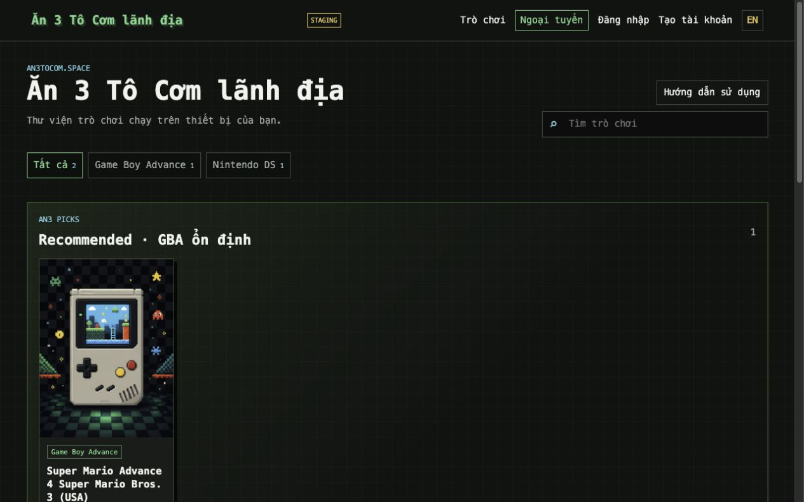

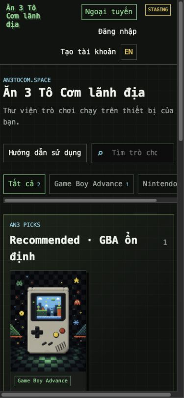

No-match search removes the library without an explanation, result count, or recovery action.

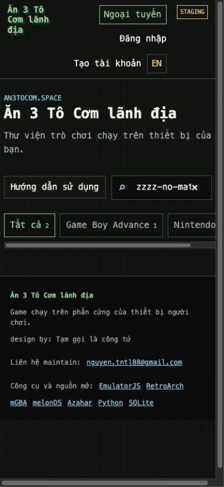

### 2. Understand a game and start Play

This is a sparse detail fixture. It proves the small-state composition only; populated description/media/comments were not captured and would appear before the action group.

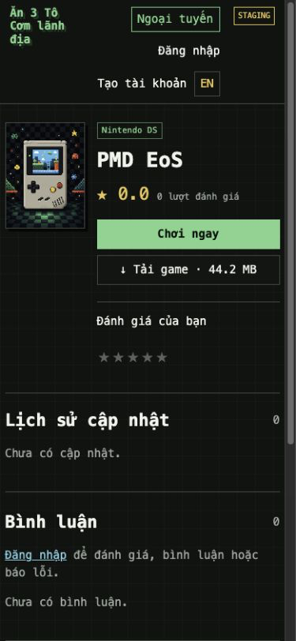

The protected player capture stops at 92%. It is rejected as a ready-state golden and cannot support touch, fullscreen, menu, slots, pad, or error approval.

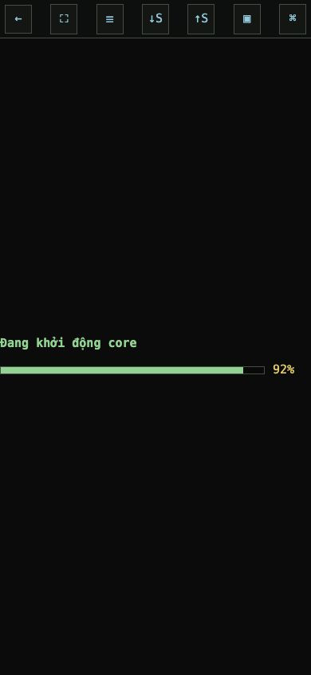

### 3. Prepare offline play

The add-ROM form is clear, but the all-core manager dominates the first view and pushes the local library far below it.

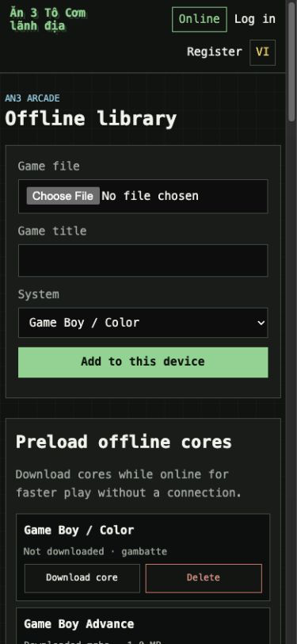

### 4. Authenticate and learn the product

The registration capture shows idle progress leaking into the form. The guide capture shows a readable surface whose five-second auto-close and missing modal keyboard behavior block accessibility approval.

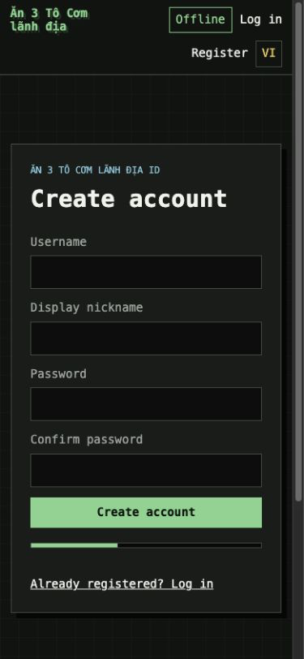

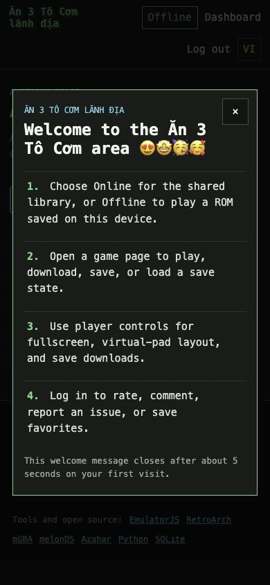

### 5. Account and operations

The account image covers an empty admin-owned fixture only. The admin image proves page-level overflow and clipped/false analytics, not populated favorites or full upload workflows.

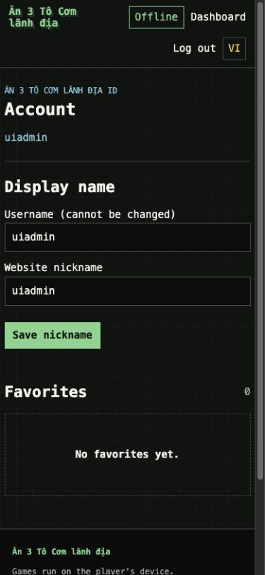

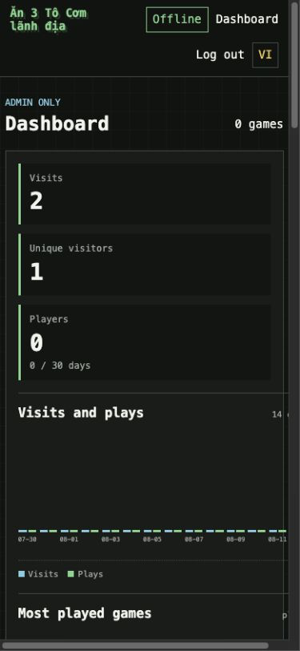

### 6. Recovery

The branded game-not-found state has no route back to browsing or search.

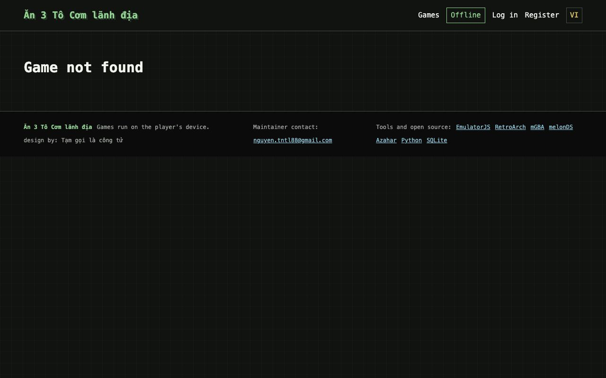

## Confirmed strengths

- Play is the dominant action on cards and game detail.
- Artwork uses a stable 3:4 slot and object-fit behavior, which is a useful layout constraint; CLS itself was not measured.
- Core text colors are strong: muted text is 7.60:1 on the base background; green is 10.27:1; cyan is 10.16:1; yellow is 11.48:1.
- Header, navigation, main, footer, forms, tables, and most headings use semantic HTML.
- The game-detail mobile layout has no horizontal overflow and keeps Play large.
- `prefers-reduced-motion` disables transitions and smooth scrolling, but does not stop the auth progress keyframe.
- Offline readiness is derived from actual IndexedDB/Cache Storage inspection rather than a cosmetic flag.
- Player DOM, NDS touch mapping, core selection, storage, ZIP/Range, and cross-origin isolation have explicit regression tests.

## Prioritized findings

| Severity | Finding | Evidence | Recommendation |
| --- | --- | --- | --- |
| P0 gate | Mobile browse/search violates the required reflow gate | Homepage document width 355px vs 345px client at 360; visible page-level scrollbars at 360/390; the primary browse/search journey is structurally clipped | Resolve page-level overflow before any visual candidate is considered implementation-ready; keep any intentional chip scrolling inside a named, bounded control |
| P0 gate | Protected player evidence is incomplete | Both `04-player-pmd-*` captures stop at 92%; no ready NDS/GBA, portrait/landscape, fullscreen, menu, slots, pad, or fatal-error baseline exists | Recapture release-matched stable ready/error/panel states and run touch/fullscreen/save regression gates before changing or approving the player shell |
| P1 | Mobile entry is navigation-first, not artwork-first | `01-home-staging-390.png`, `01-home-staging-360.png`; at 360×800 the header is 178px and first cover starts around y=616 | Replace wrapping guest navigation with a compact mobile header/menu; keep Online/Offline directly reachable; compress intro/search/filter spacing so art appears in the first half viewport |
| P1 | Admin surface overflows horizontally | Admin width 400px vs 375px client; visible page-level scrollbar and clipped chart in `09-admin-empty-local-390.png` | Make every dashboard section client-safe and provide a 320px-readable textual/visual analytics representation |
| P1 | Search no-match is a silent dead end | `11-search-no-results-staging-1280.png`, `11-search-no-results-staging-390.png`; DOM contains filters and footer but no result status | Add an announced result count/no-result state, preserve the query, expose one-click Clear, and keep filter selected state semantic |
| P1 | Offline game ownership is visually subordinate to implementation details | `08-offline-mixed-local-390.png`; 25 core cards; core block 3,212px; local games begin at y≈3,790 | Put “Games on this device” immediately after add/import; replace the full core wall with readiness summary plus relevant/recent systems and an expandable manager; show HTTP/HTTPS capability at page entry |
| P1 | Auth idle state falsely looks busy | `02-login-idle-staging-1280.png`, `07-register-local-390.png`; `#authProgress` has `hidden` but `.auth-progress{display:grid}` overrides it | Add `.auth-progress[hidden]{display:none}` and show progress only after submit; keep field error and retry state stable |
| P1 | Guide dialog is not keyboard-operable as a modal | `10-guide-modal-local-390.png`; after open, active element remains `#guideButton`; Escape leaves dialog visible | Move focus into dialog, trap Tab while open, close on Escape/backdrop, restore trigger focus, and avoid auto-closing while a user is reading or interacting |
| P1 | Admin chart and upload progress visually misrepresent state | Chart heights plus `#adminProgress`/`#bulkProgress` widths are set with inline styles; the normal CSP disallows them, so chart values flatten and upload feedback may freeze | Prefer native `<progress value max>` or another attribute/class-driven pattern, preserve textual values/status, and do not weaken `style-src` |
| P1 | Signed-in mobile navigation loses Account/Favorites | `.account` is hidden at ≤820px and no equivalent menu route is provided for a normal non-admin user | Keep Account/Favorites reachable through a compact mobile navigation pattern without changing authorization behavior |
| P1 | Several interactive boundaries fall below non-text contrast | Border `#3e4d43` on input `#0b0e0c` is 2.17:1; inactive star `#59635c` on panel `#171c19` is 2.77:1 | Raise input/control borders and inactive interactive states to at least 3:1; keep current high text contrast |
| P1 | Search and artwork links have weak accessible names | Search DOM name is `⌕`; cover anchors wrap `img alt=""` and are focusable but unnamed | Give search a localized visible or programmatic label; make cover link/name meaningful or remove it from the tab order as an exact duplicate of the title link |
| P2 | Sparse Recommended wastes space and duplicates content | `01-home-staging-1440.png`; one 216px card inside a 1,180px section; same game repeats below | Use a compact featured rail or responsive shelf; avoid repeating a single card when the library is sparse |
| P2 | Global monospace makes the consumer experience feel like an admin/debug surface | All public typography uses `ui-monospace`; baseline screenshots | Introduce a legible display/sans pairing while retaining monospace only for labels, system tags, sizes, dates, and technical status |
| P2 | Active filters are visual-only | Filter buttons toggle `.active` but no `aria-pressed`/selected state | Add semantic state and an announced result count; keep keyboard activation native |
| P2 | Core Delete buttons look actionable while disabled | `08-offline-mixed-local-390.png`; disabled buttons retain the red active treatment | Add a clear disabled style and retain the actual `disabled` attribute |
| P2 | Player controls are compact and symbol-heavy | `04-player-pmd-390.png`; toolbar buttons are 34×36px and title is hidden | Improve icons/labels and spacing within the existing toolbar budget; target 44px where it does not reduce touchscreen stage; do not change stage geometry or overlays |
| P2 | Guest game detail exposes controls that lead away instead of explaining first | `03-game-detail-pmd-390.png`; rating stars precede login explanation | Present a compact sign-in prompt before contribution controls, or disable them with clear explanation; hide empty report container for guests |
| P2 | Login breaks contribution journey continuity | Successful non-admin login always redirects to `/`, even when initiated from a game favorite/rating/comment task | Preserve and validate a same-origin return target where safely compatible with current auth boundaries; treat this as behavior friction, not permission for an auth refactor |
| P2 | Form instructions and errors are uneven | Comment/report textareas rely on placeholders; auth password rule is implicit; auth error is not `role=alert` | Add persistent labels/help, connect errors with `aria-describedby`, and announce blocking errors |
| P2 | Error states do not recover | `06-game-404-local-1280.png` | Add Return to library and Search actions; use the same branded error pattern for generic 404/403 where appropriate |
| P2 | Artwork delivery is the dominant static cost | `default-cover.png` is 1,103,173 bytes at 1086×1448 and is preloaded in the PWA app shell | Resize/compress the fallback, add a responsive cover pipeline or variants, and avoid serving original multi-megabyte uploads into small card slots |
| P2 | Lead artwork is lazy even though artwork should dominate | The first Recommended/card image is emitted with `loading="lazy"`; no LCP measurement is available | Measure the candidate first, then eagerly load only the true lead image if supported by evidence; do not report an LCP improvement without a browser metric |
| P2 | Reduced-motion coverage misses the auth keyframe | The reduced-motion rule removes transitions/smooth scrolling but leaves `auth-progress` animation active | Disable the keyframe under `prefers-reduced-motion: reduce` and verify the idle/pending states |
| P2 | “Online/Offline” can be misread as live readiness | The header label changes by destination; it does not prove network, local ROM, cached core, app shell, or secure context | Label the navigation destination clearly and represent core cached, ROM local, app shell cached, and secure-context capability as separate verified facts |
| P3 | Grid background, hard shadows, and repeated borders compete with artwork | All baseline screens | Retain personality but reduce background contrast and border/shadow frequency so game covers become the strongest visual layer |

## Product-specific safety boundaries

- Do not add sticky UI or overlays over `.player-stage` or `#game`.
- Decorative player elements must not intercept pointer events; `.player-hints` must stay `pointer-events:none`.
- Do not change canvas padding, border, transform, aspect ratio, containment, or z-order used by geometry-mapped NDS touch.
- Do not change virtual-control dimensions, hitboxes, transforms, input indices, or default coordinates as part of visual polish.
- Scope consumer/admin tokens, typography, and generic element styles away from `.player-page`, `.player-stage`, `#game`, canvas, and `#tvPad`; the current global stylesheet also reaches EmulatorJS-injected UI.
- Use system or same-origin local fonts/icons only; external CDN assets conflict with CSP and offline behavior.
- Keep server and offline player markup synchronized.
- Keep offline state language factual and separated: navigation destination, network reachability, local ROM, cached core, cached app shell, and secure context are different facts. A ROM download is not proof of offline readiness.
- Any visual requirement that needs NDS input changes is `BLOCKED_FOR_SEPARATE_TOUCH_TASK`.

## Evidence limits and verification gaps

- Staging has only two games and both use the fallback image; the audit cannot claim production artwork quality or full 29-game density. No populated detail media/comments, active-result density, authenticated contribution, populated favorites, or complete admin upload/edit/report workflow was captured.
- Screenshots cannot establish screen-reader output, full keyboard order, zoom at 200–400%, or physical touch accuracy.
- Both player captures stop at 92%; ready NDS/GBA, portrait/landscape/fullscreen, menu, slots, pad, fatal error, local-ROM player, and physical-touch states are explicitly not captured. Accelerated EmulatorJS canvas screenshots may also be black/blank even when a game runs, so runtime success requires core-start and save-state evidence.
- The available browser inspection surface did not expose reliable LCP, CLS, INP, or a complete network request timeline. These metrics remain unavailable, not zero.
- Installed-PWA restart after network loss cannot be reviewed on current LAN HTTP staging. It requires HTTPS staging or a separate secure test origin plus manual installed-PWA QA; production is not a design-review environment.
