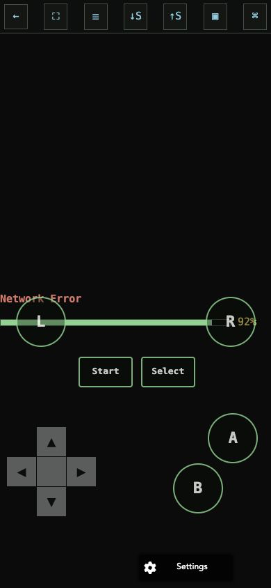
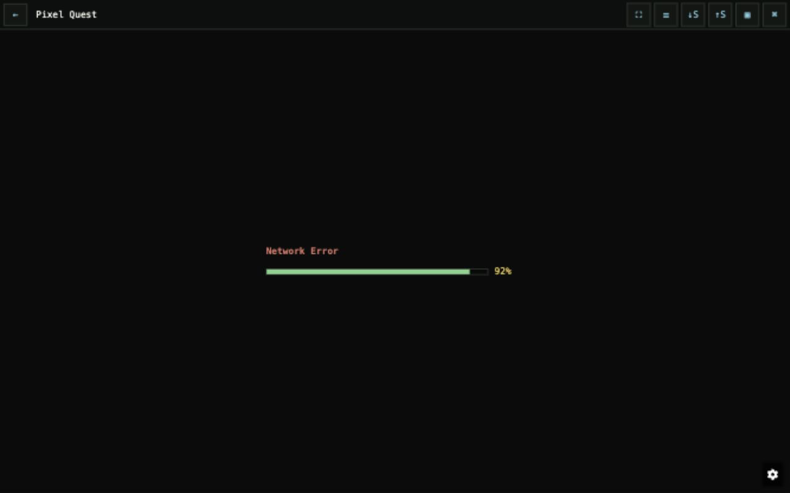

# Batch 04 — Player semantics

## Scope

This batch changes accessibility semantics only. It does not change EmulatorJS configuration, player boot, ROM delivery, storage, fullscreen behavior, virtual-controller input, NDS touch handling, panel geometry, pointer events, transforms, or z-index.

Changes:

- names the player toolbar and every icon-only control;
- gives the HTML5 player iframe a title;
- exposes startup progress through `role="progressbar"`, `aria-valuenow`, and `aria-valuetext`;
- exposes startup failures as a live status;
- names the save-slot and virtual-controller dialogs, including their close controls;
- mirrors the same semantics in the offline-generated player shell without changing its IDs, hooks, or script order.

## Captured evidence

The isolated fixture has no ROM payload. Both screenshots therefore document the real loading/error shell only; they are not evidence that a game reached a ready state.

### 390 × 844 — error shell

### 1280 × 800 — error shell

Browser accessibility-tree checks confirmed:

- toolbar name: `Player controls`;
- controls: `Back to game details`, `Fullscreen`, `Emulator menu`, `Download save state`, `Load save state`, `Save slots`, `Virtual controls`;
- progress name: `Startup progress`;
- error announcement: `Network Error`.

## Verification

- `python3 -m py_compile app.py`: pass
- `node --check static/player.js`: pass
- `node --check static/offline.js`: pass
- `python3 -m unittest discover -s tests -v`: 6/6 pass
- `git diff --check`: pass

## Remaining mandatory player gate

`P0 EVIDENCE BLOCKER`: a staging candidate with real ROM/core data must still prove ready NDS and GBA states, portrait and landscape behavior, fullscreen, emulator menu, save slots, virtual controls, failure recovery, and NDS touchscreen/pointer behavior. No production-readiness claim may use these loading/error screenshots as a substitute.
