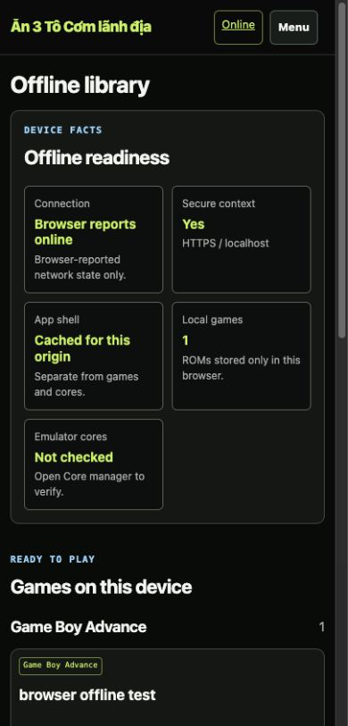
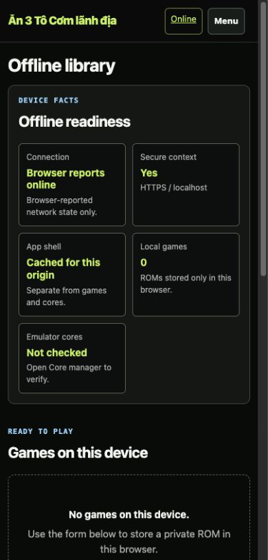
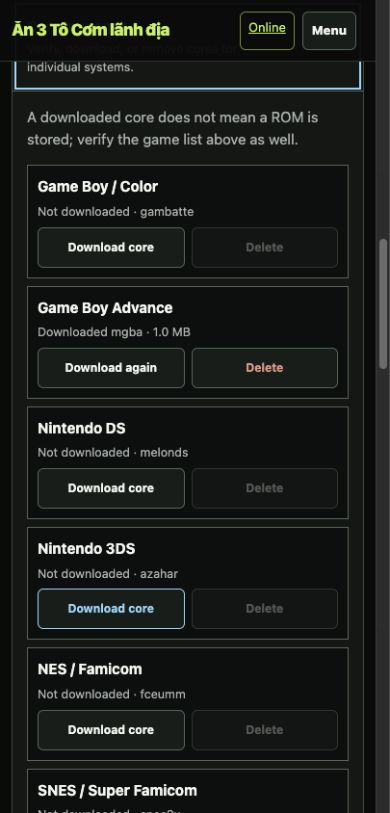

# Batch 05 — Offline library and PWA clarity

## Outcome

The offline page now treats five separate facts as separate facts: browser-reported network state, secure context, cached app shell, device-local ROMs, and emulator cores. The green `Online` header control remains a destination back to the shared library; it is not presented as connectivity.

The page order is now:

1. device facts;
2. local games and Play;
3. add a private ROM;
4. a collapsed Core manager.

The 25-system core inspection no longer runs when the page opens. It starts only after the user opens Core manager. IndexedDB names, keys, CacheStorage inspection, core-download behavior, offline player hooks, and offline/player script order are unchanged.

## Captured evidence

All files are lossless PNG. Named widths are verified CSS viewport widths, not just the browser frame width. For every responsive capture, `documentElement.clientWidth`, `documentElement.scrollWidth`, and `body.scrollWidth` matched the named width.

| File | CSS viewport | State | SHA-256 |
| --- | ---: | --- | --- |
| `offline-populated-css1440.png` | 1440 | one local GBA ROM, Core manager closed | `2be9ae43846dc5fb3ab832d6537df698b63e146aecceccc043f6323caa3aee9e` |
| `offline-populated-css1280.png` | 1280 | one local GBA ROM, Core manager closed | `09dff9ef52382f53712c496d91593724ddeb6d711f0e8a0a2431a854e7060bb5` |
| `offline-populated-css768.png` | 768 | one local GBA ROM, Core manager closed | `1841647dc0d1be5554f1046304f3fc97bc7819d6221d760d21f225a95a75d20f` |
| `offline-populated-css390.png` | 390 | one local GBA ROM, Core manager closed | `03a0499b2ef0d22fe757efec6e491d17340b089a06a7aaf24395f5963d2a3d26` |
| `offline-populated-css360.png` | 360 | one local GBA ROM, Core manager closed | `44c2fbf22135ef27069e9c9f018dce4cd862c4ab82764b34f9dd34123ab5b3b5` |
| `offline-empty-css390.png` | 390 | separate local origin, zero local ROMs | `3ff209cbaa560cf47b07f935fdbce5067ec8313b114ae18b34ee87e18a5cd3f2` |
| `core-manager-open-css390.png` | 390 | 25 systems inspected; GBA cached; 24 unavailable deletes disabled | `11064e7635c56216f257fffab7c0938900612edb30af8877e747b3e7ec46e7bb` |

### Populated local library — 390 CSS px

### Empty local library — 390 CSS px

### Core manager mixed state — 390 CSS px

## Browser checks

- closed Core manager created `0` core rows on initial load;
- opening it created `25` system rows and reported per-system state;
- populated mixed state exposed one downloaded GBA core and disabled 24 unavailable Delete actions;
- local ROM cards expose `Play now`, `Download file`, and `Remove` by name;
- mobile and desktop evidence had no page-level horizontal overflow;
- empty and populated device-local game states were both captured from real IndexedDB states.

## Verification

- `python3 -m py_compile app.py`: pass
- `node --check static/offline.js`: pass
- `python3 -m unittest discover -s tests -v`: 6/6 pass
- `git diff --check`: pass

## Not yet proven

- installed-PWA restart while disconnected;
- HTTPS non-localhost staging behavior;
- successful core download on the candidate staging release;
- successful offline player boot with a real local NDS/GBA ROM;
- storage persistence after browser eviction pressure.

These remain staging/secure-origin gates. Localhost's secure-context status is useful implementation evidence but is not a substitute for HTTPS staging or an installed-PWA restart test.
