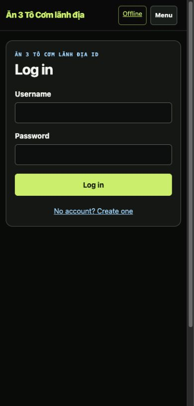
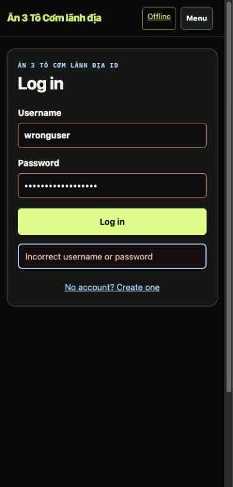
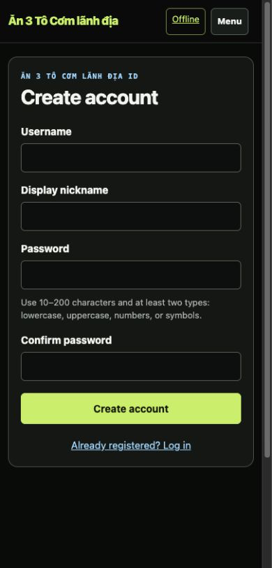
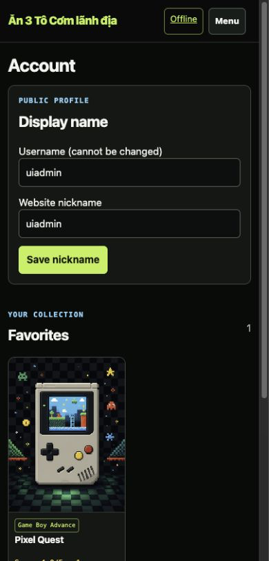

# Batch 06 — Authentication and account

## Outcome

Authentication now preserves the user's intended same-origin page. A guest who selects Log in from a game detail is returned to that game after authentication, with rating and favorite controls available. The redirect target is validated server-side; absolute, protocol-relative, backslash, non-path, and control-character targets fall back to the safe default.

Registration exposes the server's password rules before submission. Authentication failures are announced through a focused live alert, and relevant fields receive `aria-invalid`. The account page uses the same artwork-led card language as the shared library and gives display-name saves inline status in addition to the existing toast.

## Captured evidence

All evidence files are lossless PNG. Named widths are verified CSS viewport widths, and browser checks confirmed `clientWidth == scrollWidth` for the 390 and 1280 states.

| File | CSS viewport | State | SHA-256 |
| --- | ---: | --- | --- |
| `login-return-css390.png` | 390 | login with a validated `/game/pixel-quest` return target | `9bb3196386454364df20c48f4575e907c1ed11835e2b69579217e0ced6b8797b` |
| `login-error-css390.png` | 390 | localized invalid credentials; focused live alert and invalid fields | `be1ce2bd0f422a35503dfef482b1307264005df78d2f257d1cad1700f2d11e13` |
| `register-rules-css390.png` | 390 | visible password requirements associated with both password fields | `63dd74c72d83f681720a78655c90f070a246b3679e231d4096ff5507c16b8772` |
| `account-populated-css390.png` | 390 | authenticated account with one real fixture favorite | `ee85759916e98dd3b7e71f23e03d51fc0353a22ec16661e67995d14e7d0dae80` |
| `account-populated-css1280.png` | 1280 | authenticated desktop account with one real fixture favorite | `e08290677d46c18e30d6be109d7f025329f7c92c68cce615a61fb984054d12b2` |

### Login with return target — 390 CSS px

### Login error — 390 CSS px

### Registration rules — 390 CSS px

### Populated account — 390 CSS px

## Browser journey checks

- guest game detail exposed `/login?next=%2Fgame%2Fpixel-quest`;
- login and registration switches preserved the same target;
- successful admin-fixture login returned to `/game/pixel-quest` instead of the default dashboard;
- the returned game exposed five rating controls and the existing favorite state;
- an external `https://evil.example` target was replaced by `/` before submission;
- invalid credentials focused `#formError`, exposed `role="alert"`, and set both submitted fields invalid;
- login and password-validation errors follow the active VI/EN locale;
- editing an invalid field clears its stale invalid state and alert;
- registration rules are associated to both password inputs;
- display-name submission produced inline `Nickname saved.` status;
- first favorite artwork is eager/high-priority and has meaningful alternative text;
- 390 and 1280 account views had no horizontal overflow.

## Verification

- `python3 -m py_compile app.py`: pass
- `node --check static/site.js`: pass
- `python3 -m unittest discover -s tests -v`: 8/8 pass
- new redirect-sanitizer unit coverage: 2/2 pass
- `git diff --check`: pass

## Boundaries

Session cookies, password hashing, authentication rate limits, CSRF, role checks, account data, and authorization behavior are unchanged. This batch only carries a validated same-origin destination through the existing login/registration response.
