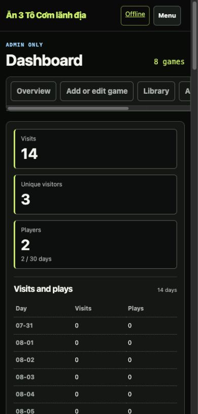
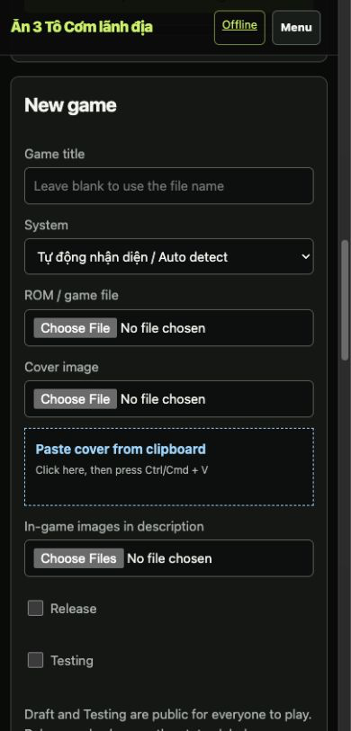
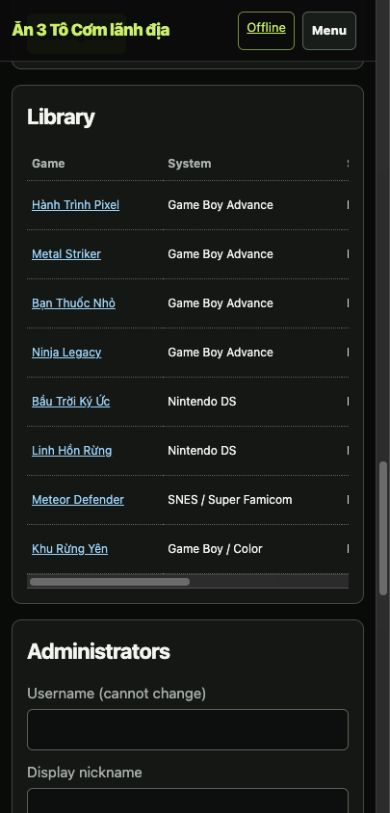
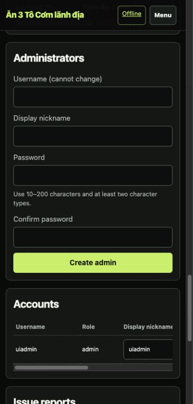

# Batch 07 — Admin operations

## Outcome

The admin dashboard now has a compact task navigation for Overview, Add or edit game, Library, and Accounts and reports. The mobile page contains wide data tables inside their own scroll regions instead of widening the page.

The CSP defect is removed without relaxing `style-src 'self'`:

- the 14-day analytics visualization uses semantic table data and native `<progress value max>` elements;
- batch and single-game upload feedback use native `<progress>` elements;
- client upload code updates the `value` property instead of `style.width`;
- chart HTML has no inline `style="height:…"` attributes;
- app-owned admin DOM had zero inline style attributes during browser QA.

Upload endpoints, resumable/chunked upload logic, metadata writes, rollback cleanup, and library data behavior are unchanged.

## Captured evidence

All evidence files are lossless PNG. Named widths are verified CSS viewport widths; `documentElement.clientWidth` and `documentElement.scrollWidth` matched at 1440, 1280, 768, 390, and 360.

| File | CSS viewport | State | SHA-256 |
| --- | ---: | --- | --- |
| `admin-overview-css1440.png` | 1440 | overview and 14-day data | `5eef7ef93a34fc99f5199c47c15f2a16ae0e0570dc308fdf060935a11b95d47c` |
| `admin-overview-css1280.png` | 1280 | overview and 14-day data | `939849fed3a5d559406bc97fa44026081f47d5193e528fcd297103bf28e8ad19` |
| `admin-overview-css768.png` | 768 | overview responsive state | `63d1b602d6abfdaf59f3771d1636cb56b789e045a83e177d49df77a14b89c33b` |
| `admin-overview-css390.png` | 390 | overview, task nav, compact analytics table | `ec301511eee4c0a490f5925001c4ffacbf81489ae7d169bbbba592a061f9dda4` |
| `admin-overview-css360.png` | 360 | narrow-mobile overview | `8f0cd9d7601a9cfc72c84f85d4596da6482839a6faa2977e5e279febaa6eb80d` |
| `admin-form-css390.png` | 390 | add-game task anchor and form | `de8c1ea2bf01b6572f8d4b5f1e58dd0b2959c75d9627e5469ff825f438b0e6fd` |
| `admin-library-css390.png` | 390 | eight-game fixture library with contained table scroll | `e5710372b0b23514b9b0eed60f49a4c1289dcf6dc06f2773a14505635453ce38` |
| `admin-operations-css390.png` | 390 | labelled administrator/account/report operations | `90a164ff4d732a030583c30f71a7b20c04e371adccae69d68712f68417b1f695` |

### Overview — 390 CSS px

### Add game — 390 CSS px

### Library — 390 CSS px

### Accounts and reports — 390 CSS px

## Browser checks

- mobile task anchors placed their target 88 CSS pixels below the sticky header;
- the 390 analytics table had `clientWidth == scrollWidth` (`334px`) with no internal horizontal overflow;
- the task nav is intentionally horizontally scrollable (`376px` client / `558px` content) so all task names remain readable;
- the 390 library table scroll is contained (`334px` client / `650px` content) while page width remains 390;
- analytics exposed 28 named progressbars across a semantic 14-row table;
- batch and game upload progress both exposed native progressbar roles and names;
- library actions expose Play, Edit, and Delete as text controls;
- admin-create inputs have visible labels and password help;
- no CSP/refused-style errors appeared in browser logs;
- app-owned admin DOM contained zero `[style]` attributes.

## Verification

- `python3 -m py_compile app.py`: pass
- `node --check static/site.js`: pass
- `python3 -m unittest discover -s tests -v`: 9/9 pass
- new CSP/progress invariant test: pass
- existing resumable/chunked upload integration test: pass
- `git diff --check`: pass

## Remaining staging evidence

A real browser file upload was not executed in this local in-app-browser pass. Staging must still capture a small direct upload and a large/chunked upload, verify visible progress movement, confirm library creation/edit state, and verify failed-upload cleanup. The existing integration suite proves the API and resumable behavior, but it is not visual progress evidence.
