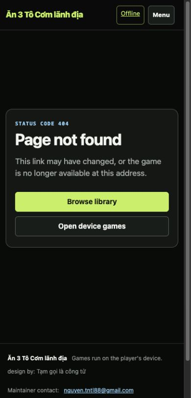
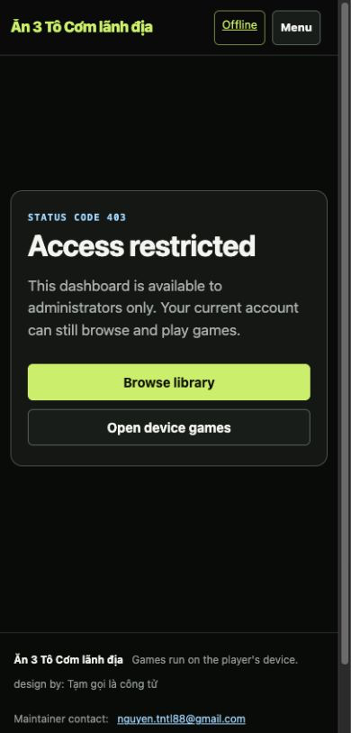
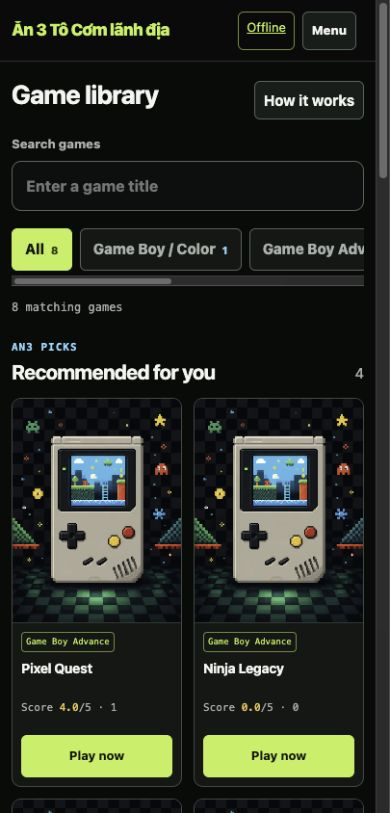

# Batch 08 — Recovery states and measured frontend weight

## Recovery states

Unknown browser routes, unknown games, unknown players, and non-admin dashboard access now use the shared site shell with a clear status code, explanation, and two recovery actions. Unknown API routes continue returning JSON `404` responses.

### 404 — 390 CSS px

### 403 — 390 CSS px

Browser checks confirmed no page-level horizontal overflow at 390 or 1280. The 403 evidence uses a genuine normal-user session attempting `/admin`, not a mocked DOM state.

| File | CSS viewport | SHA-256 |
| --- | ---: | --- |
| `404-css390.png` | 390 | `c19b0e0eea5d204701dff263daf84dd1efc0556d2201360e361695d4d6608710` |
| `404-css1280.png` | 1280 | `2615aa00787a0d5db4d153178293510cf909f12e827f475380d744950342183c` |
| `403-css390.png` | 390 | `acf07479a475d7099ceeda8e54760cefb220729d2074d34aa07bf985cd6e38ae` |
| `home-optimized-fallback-css390.png` | 390 | `eabb0650833e6aca21588a3c1948e817730552ba091dffa492fa4456f1e43340` |

## Fallback artwork

The shipped fallback is now a 720×960 WebP at 29,930 bytes. Cards and detail artwork declare `width="720" height="960"`; the true leading recommended image is eager/high-priority while remaining card images stay lazy. The legacy PNG path is retained as a resized 720×960 compatibility asset, but is no longer referenced by the UI or app-shell cache.

| Asset | Baseline | Candidate | Change |
| --- | ---: | ---: | ---: |
| served fallback artwork | 1,103,173 B PNG, 1086×1448 | 29,930 B WebP, 720×960 | −1,073,243 B / −97.3% |
| legacy PNG retained outside app shell | 1,103,173 B | 537,186 B | −565,987 B / −51.3% |
| tracked `static/` files | 1,553,087 B | 1,057,681 B | −495,406 B / −31.9% |
| PWA app-shell local static bodies | 1,219,607 B | 187,014 B | −1,032,593 B / −84.7% |

The PWA shell version changes from `v17` to `v18`; the existing activation logic still migrates cached emulator assets into the separate core cache before removing old shells.

### Optimized fallback in the real library — 390 CSS px

The browser reported a natural image size of 720×960, declared size 720×960, `/static/default-cover.webp`, `loading="eager"`, and `fetchpriority="high"` for the lead card.

## HTML, CSS, JavaScript, images, and requests

These are measured body/file bytes. The local fixture and current staging contain different data, so dynamic HTML sizes are recorded but not treated as a controlled before/after comparison.

| Surface | Current staging before candidate | Local candidate |
| --- | ---: | ---: |
| `/` HTML body | 6,325 B | 14,745 B |
| `/offline` HTML body | 3,924 B | 5,741 B |
| `site.css` raw / gzip-9 | 24,661 / 6,082 B | 56,569 / 11,094 B |
| `site.js` raw / gzip-9 | 19,875 / 5,160 B | 24,517 / 6,059 B |
| `player.js` raw / gzip-9 | 44,625 / 11,670 B | 44,945 / 11,760 B |
| `offline.js` raw / gzip-9 | 26,891 / 8,703 B | 30,671 / 9,589 B |
| service worker raw / gzip-9 | 2,755 / 1,006 B | 2,756 / 1,006 B |
| fallback image served by UI | 1,103,173 B | 29,930 B |

The design/accessibility work increases CSS and JavaScript by 40,651 raw bytes (6,887 gzip-9 bytes across CSS/site/player/offline/service-worker files). The fallback reduction is larger by more than one megabyte, so the PWA shell still falls by 84.7% overall.

On a fresh `127.0.0.1:18795` origin, the server recorded 14 GET requests in the first-install observation window: the language redirect and home navigation, page CSS/JS/cover, a favicon 404, the service worker, and the eight local app-shell requests. Their response bodies totaled 309,491 bytes excluding headers. This is an observed local first-install window, not a universal request-count guarantee; caches, authentication, locale, and service-worker lifecycle change subsequent loads.

## Unavailable metrics

Reliable LCP, CLS, and INP were not exposed by the available in-app-browser inspection surface. They remain **unavailable**, not zero, and no improvement is claimed. Runtime staging tooling or a separate approved measurement surface is still required.

## Remaining image risk

Admin cover uploads still accept original files up to 12 MiB, and the application has no generated responsive variants for uploaded artwork. Solving that safely requires a separate upload/storage migration plan; this batch does not rewrite stored assets or their data contract.

## Verification

- `python3 -m py_compile app.py`: pass
- `node --check` for all four JavaScript files: pass
- `python3 -m unittest discover -s tests -v`: 9/9 pass
- PWA v18/WebP integration checks: pass
- emulator/core/touch/PWA regression invariants: pass
- `git diff --check`: pass
