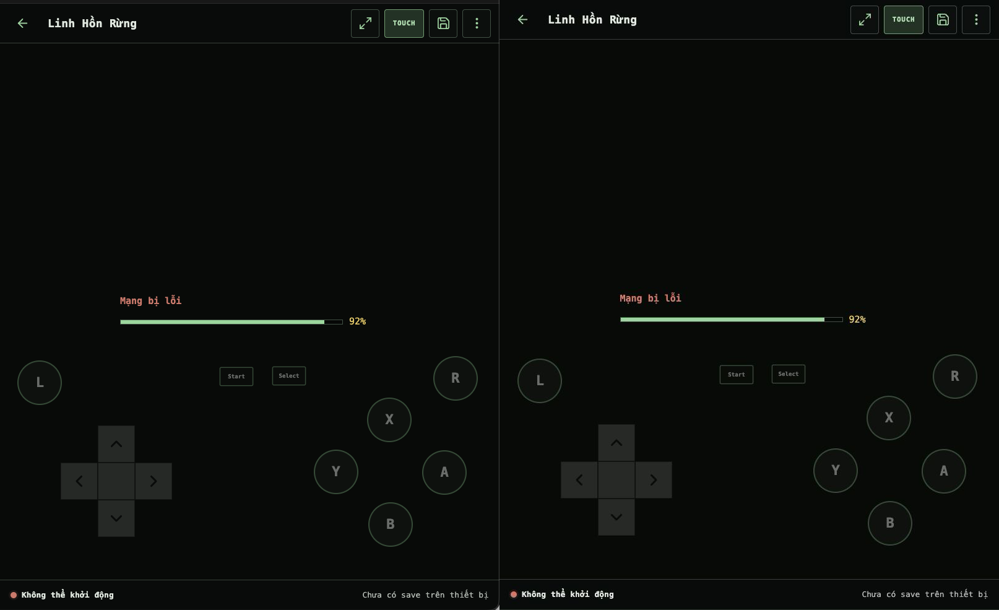

# Batch 10 — Approved default NDS control layout

## Result

Local result: passed. The supplied layout is now the NDS portrait default for new users and for `Mặc định` / `Reset`. Existing saved layouts are preserved.

## Capture manifest

| Field | Reference | Candidate |
| --- | --- | --- |
| Source | User-supplied PNG | Local development build |
| Full image | `reference-807x1025.png` | Browser viewport capture |
| Browser chrome | 40 px, removed for comparison | Not included |
| Compared viewport | 807 × 985 CSS px | 807 × 985 CSS px |
| Locale / auth | Vietnamese / guest | Vietnamese / guest |
| Data state | `forest-spirits`, network-error at 92% | Same fixture and state |
| Asset version | Not encoded in source | `e64eb1cce843` |
| Reference SHA-256 | `f12c6905fd16e49dd96452f3ff9d15ed23f1308a26fb6db41cad15f3c28aaec3` | — |
| Cropped reference SHA-256 | `0b109a80ab1524053fa1a9d1385a7428179a5499c23c339dc5ed66c10863a8bc` | — |
| Candidate SHA-256 | — | `e56c80dc82c7fe4119a58a7879e013decefcb22334a7f0b1e0b52d257a08fe97` |

The PNG candidate is a lossless container converted from the in-app Browser capture. The actual CSS viewport and image width are both 807 px.

## Exact approved preset

Coordinates are percentages of the game/pad region. The 807 × 985 candidate produced the measured control rectangles shown below.

| Control | X | Y | Scale | Measured rectangle (x, y, w, h) |
| --- | ---: | ---: | ---: | --- |
| D-pad | 23.4% | 81.6% | 140% | 99.23, 685.13, 179.20, 179.20 |
| A | 89.0% | 80.0% | 100% | 682.22, 724.80, 72, 72 |
| B | 78.2% | 89.7% | 100% | 595.06, 809.28, 72, 72 |
| X | 78.0% | 70.2% | 100% | 593.45, 639.44, 72, 72 |
| Y | 67.3% | 79.9% | 100% | 507.11, 723.92, 72, 72 |
| L | 8.1% | 63.3% | 100% | 29.36, 579.33, 72, 72 |
| R | 91.2% | 62.5% | 100% | 699.97, 572.38, 72, 72 |
| Start | 47.4% | 62.1% | 70% | 355.22, 589.49, 54.60, 30.80 |
| Select | 57.9% | 62.0% | 70% | 439.95, 588.62, 54.60, 30.80 |

Default opacity is 48%. The opacity input now supports 1% steps, so the settings panel represents the preset without rounding it to 50%.

## Responsive and interaction QA

- 807 × 985: exact approved coordinates, sizes, and 48% computed opacity; no horizontal overflow.
- 390 × 844 and 360 × 800: every control remains inside the game/pad rectangle and page overflow is zero. A narrow-screen render clamp protects the L/R edge without changing stored coordinates or the 807 px reference geometry.
- 844 × 390: all controls remain inside the player surface with no page overflow or default collisions.
- Touch off hides only the virtual controls; the Touch button remains visible and reports `aria-pressed=false`. Touch on restores the overlay.
- The settings panel reports D-pad 140% and opacity 48%. Reset restores the exact preset map.
- `candidate-final-360x800.png`, `candidate-final-390x844.png`, and `candidate-final-landscape-844x390.png` record the responsive states.

## Safety and tests

- NDS touch dispatch, input indices, fullscreen, save storage, core storage, and emulator configuration were not changed.
- 11/11 Python tests passed.
- Python and all four JavaScript files passed syntax checks.
- `git diff --check` passed.
- The local fixture has no representative ROM, so ready gameplay, physical multi-touch, rotation, and fullscreen remain staging gates rather than claimed local evidence.

