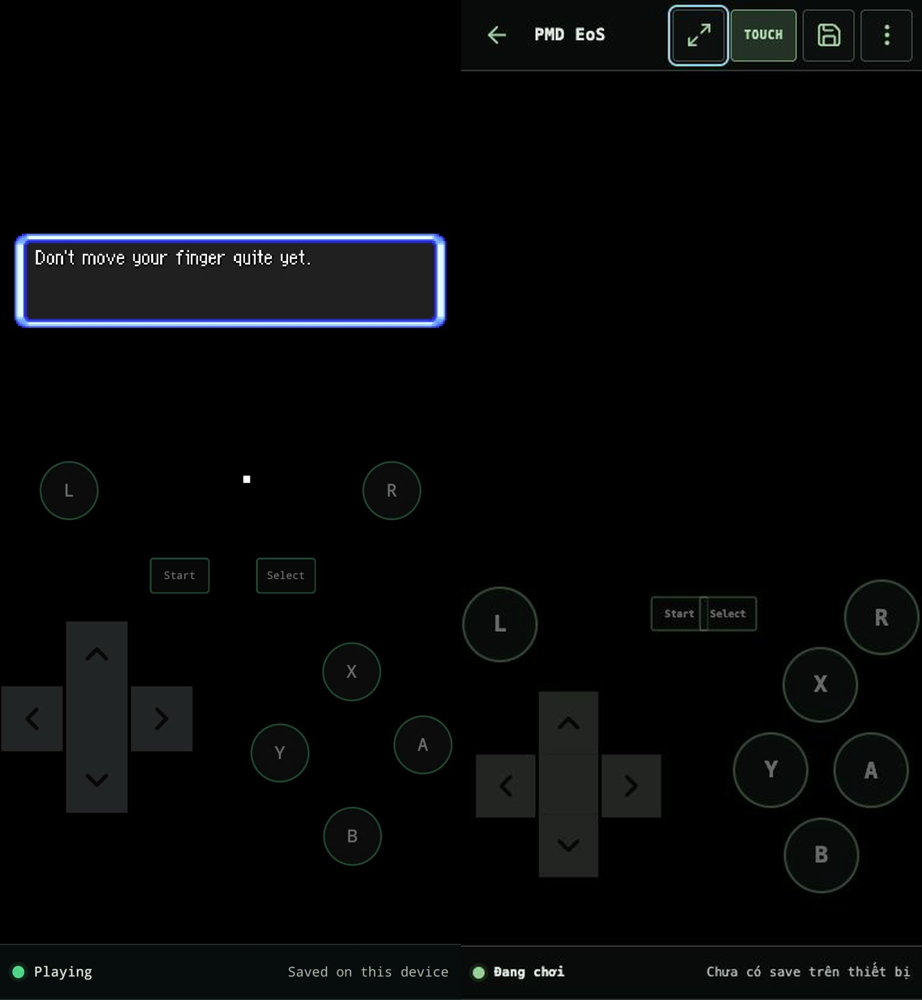
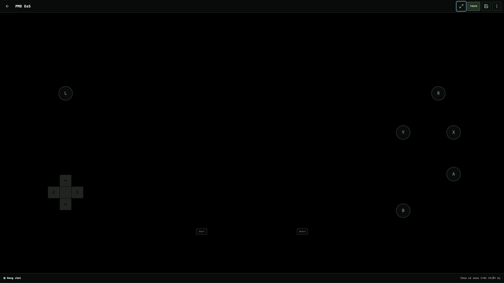
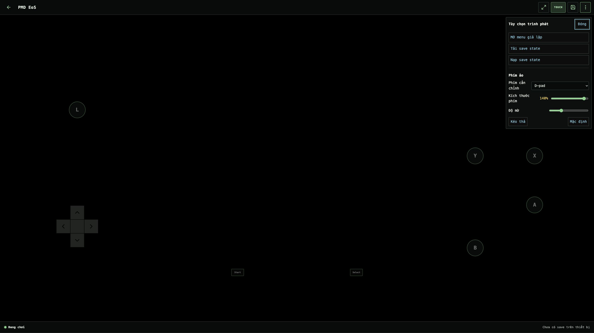

# Batch 11 — Keep the gameplay menu in fullscreen

## Result

**Staging visual and functional QA: passed.**

The fullscreen target is now the complete player shell instead of only the emulator stage. Browser chrome still leaves the screen, while the AN3 toolbar, game surface, virtual controls, status rail, and opened player panels remain inside fullscreen.

Staging route: `http://192.168.1.11:8092/play/pmd-eos?qa=fullscreen-shell-staging`

## Source truth and comparison

The supplied normal-mode reference establishes the required toolbar. The supplied fullscreen reference shows the regression: the toolbar disappears while the game and status rail remain.

For this comparison, the staging 390 × 844 CSS capture was losslessly scaled to the supplied image's exact 869 × 1884 pixel dimensions. The right-hand candidate preserves the requested AN3 toolbar and status rail in the same portrait composition. Emulator framebuffer timing differs and is not treated as app UI.

## Actual fullscreen evidence

The in-app browser exposes actual fullscreen at its physical 2560 × 1440 viewport. The toolbar occupies the top 64 px and the status rail the bottom 50 px; neither is clipped or overlaid by the emulator.

The More menu remains interactive and visible in fullscreen, with focus moved to its Close button.

## Capture manifest

| Evidence | Viewport / output | State |
| --- | --- | --- |
| `reference-browser-toolbar-869x1884.png` | 869 × 1884 supplied pixels | Android browser, normal mode, PMD EoS, playing |
| `reference-fullscreen-toolbar-missing-869x1884.png` | 869 × 1884 supplied pixels | Android fullscreen regression, PMD EoS, playing |
| `candidate-staging-mobile-390x844.png` | 390 × 844 CSS / pixels, density 1 | Staging, Vietnamese, guest, PMD EoS, `Đang chơi` |
| `candidate-staging-mobile-normalized-869x1884.png` | 869 × 1884 pixels | Lossless nearest-neighbour normalization for the side-by-side comparison |
| `candidate-staging-fullscreen-toolbar-2560x1440.png` | 2560 × 1440 fullscreen pixels | Staging actual fullscreen, toolbar and status visible |
| `candidate-staging-fullscreen-menu-open-2560x1440.png` | 2560 × 1440 fullscreen pixels | Staging actual fullscreen, More panel open |

Staging asset version: `55491b89c142`.

## Functional and safety checks

- Toolbar, Touch, Save, More, game canvas, virtual controls, and status rail remain visible in fullscreen.
- More opens while fullscreen is active; Close receives focus and the panel stays within the fullscreen shell.
- Exiting fullscreen returns to the original 390 × 844 layout with no horizontal overflow.
- The staging canvas retains `pointer-events:auto` and `touch-action:none`.
- The NDS touchscreen bridge, controller input indices, control geometry, EmulatorJS configuration, saves, storage, and PWA behavior were not modified.
- Staging produced zero console errors during the fullscreen and menu-open checks.
- 12/12 regression tests passed, including a new invariant that fullscreen targets the player shell.

## Remaining device gate

The supplied physical Android screenshots establish the defect, but the fixed build has not yet been recaptured on that phone. Physical Android fullscreen, rotation, and multi-touch should be checked on this staging release before production approval. Production was not used for design review and was not changed by this batch.
