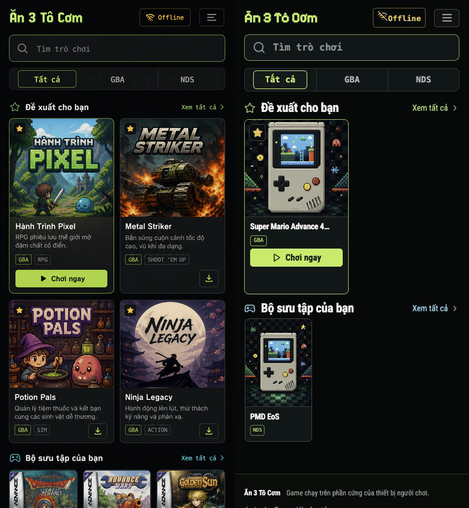
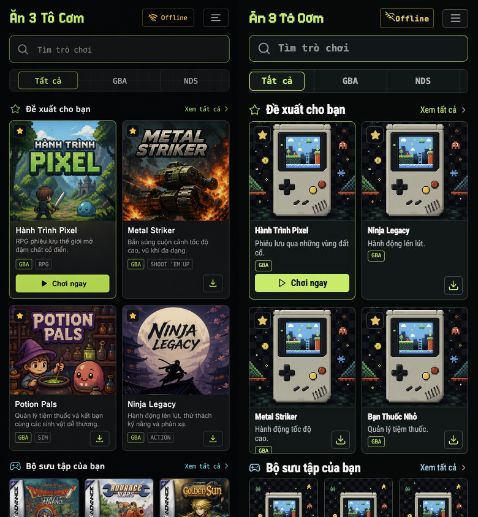
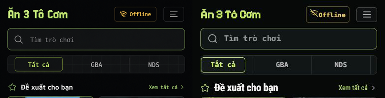
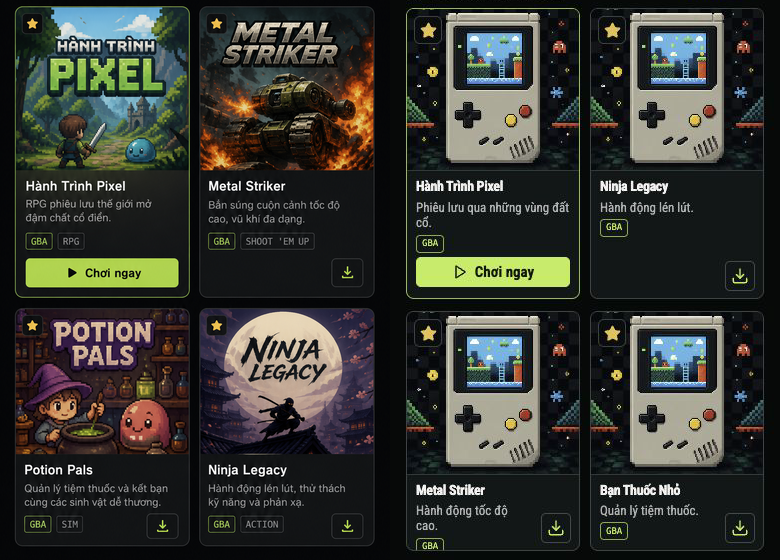
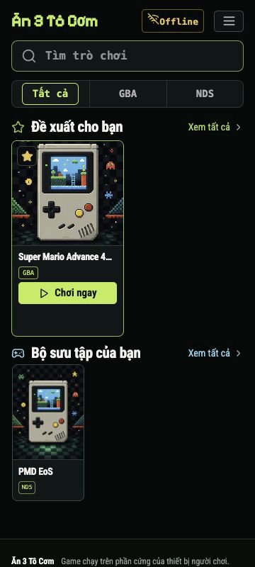
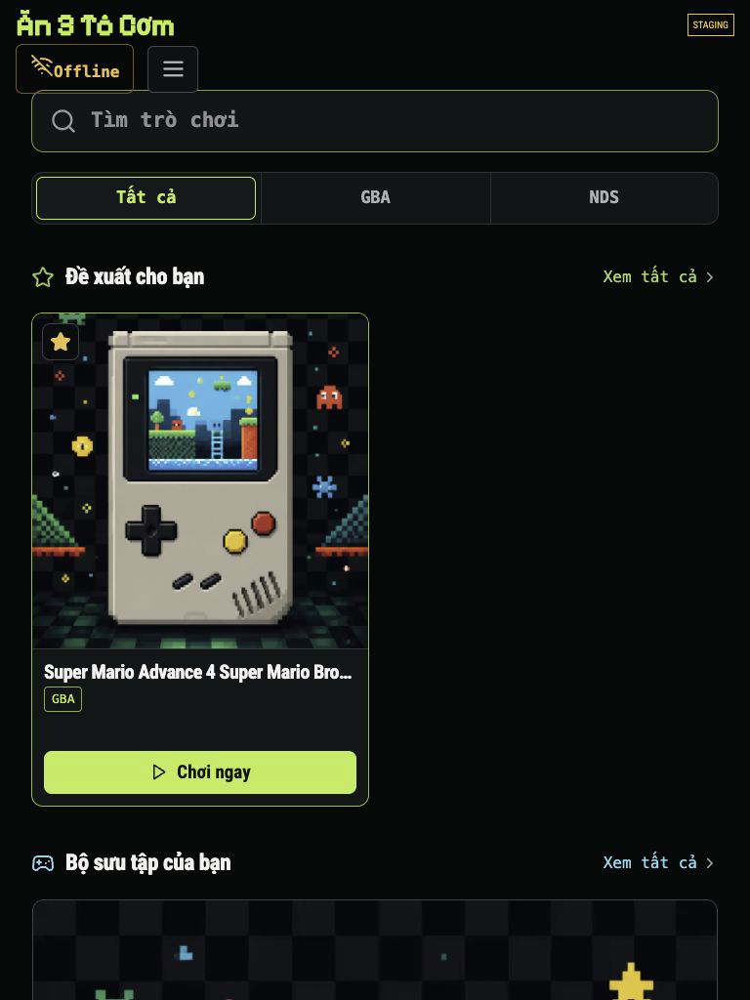
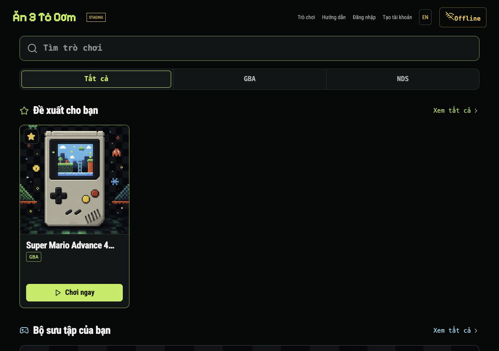

# Batch 12 — Reference-matched game library

## Result

**final result: passed**

The homepage/library implementation has no unresolved P0, P1, or P2 visual-QA finding at the required responsive widths. The candidate is deployed only to the isolated staging service. Production remains on its previous asset.

## Source truth and capture manifest

| Artifact | State | Pixels / viewport | SHA-256 |
| --- | --- | --- | --- |
| `reference-source-853x1844.png` | User-supplied generated visual, Vietnamese, dark theme, populated illustrative library | 853 × 1844 source pixels | `e885fa88fbd935c747484baa1f3588415e7bcf07a1c469351ffc56b902773b4e` |
| `reference-normalized-390x844.png` | Density-normalized reference | 390 × 844 comparison pixels | `a2f2e9141432679e6cc546f4e7b1710cde935478f352046bd3ab375ec120c819` |
| `candidate-local-final-390x844.png` | Local seeded fixture, Vietnamese, guest, dark theme | 390 × 844 CSS viewport, density 1 | recorded in repository |
| `candidate-staging-390x844.png` | Real staging data, Vietnamese, guest, dark theme, staging asset `861033db66b8` | 390 × 844 CSS viewport, density 1 | `79b61aeff326610f1dc5e6a8358637251dd37607f2def69ed26d11616d3de55c` |
| `reference-vs-candidate-staging-780x844.png` | Equal-density side-by-side comparison | 780 × 844 pixels | `0bd040628296fd85b29db2591be6fc1ad72ad3b741b94fa48a6d4f68590cf79b` |

Staging URL: `http://192.168.1.11:8092/?qa=batch-12-reference-library-4`

The source was normalized to the exact 390 × 844 CSS target before comparison. The generated source does not include browser chrome; neither candidate capture includes browser chrome.

## Full-view comparison

The staging database currently contains only two published games, so the real-data candidate intentionally has one recommended card and one collection card. The layout remains two-column and preserves the correct empty space rather than inventing games or artwork.

The seeded local comparison is retained to show populated-card density and the two-row recommendation rhythm:

## Focused comparisons

## What changed

- Rebuilt the library composition around the supplied visual: compact brand header, large search control, three equal mobile filters, artwork-led recommendation grid, explicit Play/download actions, and a horizontal collection shelf.
- Bundled Pixelify Sans for the brand and Roboto Condensed for the library UI, including Vietnamese subsets. Fonts are local and work with the existing CSP and offline shell.
- Replaced text/emoji-like controls with nine locally bundled Lucide SVG icons for offline, search, menu, recommendation, collection, play, download, and chevrons.
- Scoped the new visual system to `body.library-shell`; the player, EmulatorJS canvas, NDS touch surface, offline player, admin, and authentication layouts are not restyled by this batch.
- Preserved real game titles, covers, routes, download URLs, filter hooks, recommendation ranking, and storage behavior. No illustrative reference artwork or fake genre data was added.
- Bumped the application-shell cache to `v20` and added the new local font/icon assets without altering core-cache migration.

## Responsive evidence

| Viewport | Columns | Horizontal overflow | Evidence |
| --- | --- | --- | --- |
| 360 × 800 | 159 px + 159 px | none (`scrollWidth=360`) | `candidate-staging-360x800.png` |
| 390 × 844 | 174 px + 174 px | none (`scrollWidth=390`) | `candidate-staging-390x844.png` |
| 768 × 1024 | 346 px + 346 px | none (`scrollWidth=768`) | `candidate-staging-768x1024.png` |
| 1280 × 900 | four columns at 281.5 px | none (`scrollWidth=1280`) | `candidate-staging-1280x900.png` |

## Interaction and accessibility checks

- Search for `PMD` returns exactly `pmd-eos` and reports `1 trò chơi phù hợp` through the live status.
- The `NDS` filter returns exactly `pmd-eos`; `Tất cả` resets the filter.
- Menu open/close synchronizes its visible state and `aria-expanded`.
- Search has a programmatic name, filters expose pressed state, content sections are labeled, card detail links describe their target, and icon-only controls have accessible names.
- Browser page logs were empty after load and the tested interactions.
- The 360/390 candidates have no page-level horizontal reflow regression.

## Performance evidence

- `site.css`: 80,410 B raw / 15,543 B gzip.
- `site.js`: 24,572 B raw / 6,070 B gzip.
- `service-worker.js`: 3,544 B raw / 1,186 B gzip.
- Entire static directory: 1,288 KiB on disk; bundled fonts: 136 KiB on disk.
- The new icons are nine small local SVGs. No external font, icon, analytics, or image request was introduced.
- Browser-runtime request count, LCP, CLS, and INP were unavailable from the approved browser surface and are not claimed.

## Intentional deviations from the generated source

- The fictional cover art and genre chips in the generated reference are illustrative. Staging and production continue to render real game data and real covers; there is no genre field in the current data model.
- The staging fixture is sparse. It is not populated with fake games for the screenshot.
- The Offline control remains a destination to the offline library, not a claim about live connectivity or ROM readiness.
- The existing footer content remains after the reference-height content area. It was not removed because the source only shows the upper portion of a longer library page.

## Gates

- Staging health: pass, environment `staging`, asset `861033db66b8`.
- Production health checked read-only: pass, asset remains `e64eb1cce843`.
- 12/12 Python regression tests pass; Python, JavaScript, shell syntax, and `git diff --check` pass.
- No production deployment is included in this batch.
